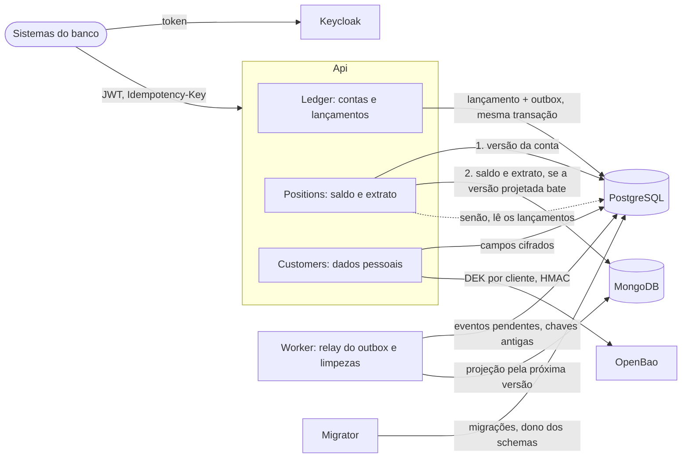

# Ledger

Ledger bancário em C#: registro de movimentações e consulta de saldo em um momento.

## Visão da solução

Um monólito modular em .NET 10, em três processos. A Api registra movimentações e responde
consultas. O Worker leva cada lançamento confirmado ao modelo de leitura e apaga chaves de
idempotência e eventos antigos. O Migrator aplica as migrações e sai. O PostgreSQL é a fonte da
verdade dos lançamentos e dos cadastros: o MongoDB é derivado e verificável contra ele. As chaves
dos dados pessoais vivem só no OpenBao; sem elas, os campos cifrados ficam ilegíveis.



Cada pergunta do enunciado, a resposta e onde ela está decidida e provada (testes em `tests/`):

| Pergunta | Resposta | Decisão | Prova |
|----------|----------|---------|-------|
| Como estruturar a solução? | Monólito modular com três módulos (Ledger, Positions, Customers) e fronteiras checadas por teste; Api, Worker e Migrator em processos separados | [ADR-0052](docs/adr/0052-monolito-modular-com-identidade-do-chamador-isolada.md), [ADR-0009](docs/adr/0009-processos-api-e-worker-separados.md) | `ArchitectureTests/ModuleBoundaryTests.cs` |
| Quais tecnologias e por quê? | .NET 10 (LTS) com Minimal APIs, e EF Core com SQL explícito onde o LINQ não expressa a garantia. PostgreSQL na escrita: transação ACID, lock por linha, `CHECK` e `UNIQUE` no próprio banco. MongoDB na leitura: saldo e extrato desnormalizados, sem disputar o banco da escrita. Keycloak: OAuth 2.0 padrão, com client credentials e token exchange. OpenBao: as chaves dos dados pessoais ficam fora do banco, e as de HMAC nunca saem do cofre. Padrões: CQRS, outbox transacional, DDD tático | [ADR-0051](docs/adr/0051-stack-dotnet-com-criterio-de-sql-explicito.md), [ADR-0004](docs/adr/0004-postgresql-como-banco-de-dados.md), [ADR-0006](docs/adr/0006-cqrs-com-modelo-de-leitura-separado.md), [ADR-0012](docs/adr/0012-autenticacao-oauth2-client-credentials.md), [ADR-0050](docs/adr/0050-criptografia-de-dados-pessoais-com-seed-de-desenvolvimento.md) | — |
| Como garantir consistência? | Lançamentos só de inserção, por privilégio de banco, com o saldo acumulado em cada um e `CHECK` contra saldo além do limite; o evento do outbox grava na mesma transação do lançamento, sem escrita dupla | [ADR-0049](docs/adr/0049-saldo-materializado-e-saldo-acumulado-com-sinal-pelo-tipo.md), [ADR-0044](docs/adr/0044-isolamento-por-schema-e-role-com-ddl-no-log.md), [ADR-0053](docs/adr/0053-relay-do-outbox-e-projecao-pela-proxima-versao.md) | `IntegrationTests/Ledger/LedgerTablesTests.cs`, `IntegrationTests/Ledger/OutboxTests.cs` |
| E a concorrência? | Lock pessimista só na conta da operação, com espera de até 2 s (`409 concurrency-timeout`); `Idempotency-Key` obrigatória em todo `POST`, então um retry nunca duplica um lançamento | [ADR-0005](docs/adr/0005-controle-de-concorrencia-por-lock-pessimista.md), [ADR-0037](docs/adr/0037-idempotencia-por-modulo-com-hash-sem-dado-pessoal.md) | `IntegrationTests/Ledger/DebitConcurrencyTests.cs`, `IntegrationTests/Ledger/IdempotencyConcurrencyTests.cs` |
| Saldo em um momento? | Tempo de registro do servidor; o saldo de um instante é o saldo acumulado do último lançamento até ele, sem somar o histórico; um instante passado nunca muda | [ADR-0002](docs/adr/0002-modelo-temporal-tempo-de-registro.md), [ADR-0045](docs/adr/0045-frescor-e-instante-passado-imutavel-na-leitura.md) | `IntegrationTests/Positions/PastInstantTests.cs`, `IntegrationTests/Positions/BalanceTests.cs` |
| Falhas parciais? | MongoDB fora, lento ou atrasado: a consulta responde pelo PostgreSQL, com o mesmo resultado. Worker fora: o outbox acumula, nada se perde. OpenBao fora: só Customers responde `503`. A readiness tira a réplica sem o PostgreSQL ou o cofre, e a mantém sem o MongoDB. Cenário a cenário no [modelo de falhas](docs/arquitetura/modelo-de-falhas.md) | [ADR-0045](docs/adr/0045-frescor-e-instante-passado-imutavel-na-leitura.md), [ADR-0053](docs/adr/0053-relay-do-outbox-e-projecao-pela-proxima-versao.md) | `IntegrationTests/Positions/BalanceTests.cs`, `IntegrationTests/Customers/VaultOutageTests.cs` |
| Alta demanda? | Leitura separada da escrita; lock por conta, não global; prazos curtos no lock (2 s), em cada comando SQL das escritas (3 s, `503 database-timeout`), no MongoDB (300 ms) e no cofre (1 s); corpo limitado a 16 KB. Os riscos aceitos estão no modelo de falhas | [ADR-0006](docs/adr/0006-cqrs-com-modelo-de-leitura-separado.md), [ADR-0021](docs/adr/0021-resiliencia-sob-carga-e-falhas.md), [ADR-0047](docs/adr/0047-limite-de-16-kb-no-corpo-da-requisicao.md) | [Teste de carga](docs/arquitetura/teste-de-carga.md): 302 req/s por 3 min 30 s (com preparo e tokens), escritas com p95 abaixo de 17 ms com leituras em paralelo |
| Dados sensíveis? | Escopo por rota e titularidade por cliente; dados pessoais só em Customers, cifrados campo a campo com AES-256-GCM e DEK por cliente no OpenBao; CPF por blind index; logs sem dado pessoal; trilha de auditoria imutável; schema e role por módulo. Ameaça a ameaça no [modelo de ameaças](docs/arquitetura/modelo-de-ameacas.md) | [ADR-0013](docs/adr/0013-autorizacao-por-escopo-e-por-recurso.md), [ADR-0050](docs/adr/0050-criptografia-de-dados-pessoais-com-seed-de-desenvolvimento.md), [ADR-0041](docs/adr/0041-trilha-de-auditoria-por-modulo.md) | `IntegrationTests/Ledger/OwnershipTests.cs`, `IntegrationTests/Customers/CustomerStorageTests.cs`, `IntegrationTests/Hosts/LogRedactionTests.cs` |
| O que documentar? | ADRs com alternativas e consequências, [mapa de decisões](docs/mapa-de-decisoes.md), fluxo de cada rota em [`docs/arquitetura/`](docs/arquitetura/README.md), contrato OpenAPI, [glossário](docs/glossario.md) e [guias didáticos](docs/guias/) | [ADR-0026](docs/adr/0026-estrutura-da-documentacao.md), [ADR-0040](docs/adr/0040-fluxo-de-cada-rota-e-rotina-conferido-contra-o-codigo.md) | Scripts de `tests/docs`, no CI |

Os testes rodam contra PostgreSQL, MongoDB, Keycloak e OpenBao reais (Testcontainers); a
concorrência é sincronizada por barreira, e o Stryker mede a mutação do domínio do Ledger
([ADR-0023](docs/adr/0023-estrategia-de-testes.md)).

### O que ficou de fora

O prazo fechou o escopo no [ADR-0054](docs/adr/0054-escopo-final-da-entrega.md). Ficaram decididos,
sem implementação: bulkhead, rate limiting e load shedding; circuit breakers; OpenTelemetry com
métricas e alertas; pedido de eliminação e crypto-shredding; CodeQL; runbook. A evolução para
produção (broker, sub-ledgers para contas quentes, sharding, mTLS, cofre gerenciado) está em
[melhorias futuras](docs/melhorias-futuras.md). Situação de cada funcionalidade no
[roteiro](docs/roadmap.md).

## Como executar

Pré-requisitos: Docker com Docker Compose; `curl` e `jq` para os exemplos.

```bash
docker compose up
```

O comando sobe o PostgreSQL e o MongoDB (modelo de leitura do saldo e do extrato), aplica as
migrações e inicia a Api (`http://localhost:8080`), o Worker (`http://localhost:8081`), o Keycloak
(`http://localhost:8180`), provedor de identidade local com o realm `ledger` importado de
`docker/keycloak/realm-ledger.json`, e o OpenBao (`http://localhost:8200`), cofre das chaves dos
dados pessoais dos clientes (ADR-0050). O Worker leva cada lançamento do outbox do PostgreSQL ao
MongoDB (ADR-0053) e apaga as chaves de idempotência e os eventos processados com mais de 7 dias.

O OpenBao sobe em modo servidor, com os dados no volume `openbao-data` e auto-unseal estático: ele
se deslacra sozinho a cada subida. Na primeira, o container `openbao-bootstrap` inicializa o cofre
e cria as chaves, a política e o AppRole da Api; nas seguintes, ele não troca nenhuma chave. A Api
só sobe depois do bootstrap e cadastra, cifrados como qualquer cliente, os clientes fictícios dos
usuários `ana` (`11111111-1111-4111-8111-111111111111`) e `bruno`
(`22222222-2222-4222-8222-222222222222`) do realm (seed ligado por `Customers__Seed__Enabled`, só no
compose). Uma conta só é aberta para cliente cadastrado.
Para conferir: `curl http://localhost:8080/health/live` e `curl http://localhost:8081/health/live`
respondem `Healthy`. A readiness, em `curl http://localhost:8080/health/ready` e
`curl http://localhost:8081/health/ready`, consulta as dependências: `Healthy` com todas de pé,
`Degraded` na Api só com o MongoDB fora, e `503` sem o PostgreSQL, sem o OpenBao (Api) ou sem o
MongoDB (Worker) (ADR-0021).

### Depois de atualizar o repositório

As roles do banco são criadas pelo script de inicialização do PostgreSQL
(`docker/postgres/init/`), e os usuários do MongoDB pelo de `docker/mongo/init/`; os dois só rodam
com o volume vazio. Uma role ou um usuário novo, como a `customers_worker` do Worker, não chega a um
volume que já existe. Depois de atualizar o repositório, recrie o
ambiente local, o que apaga os dados locais:

```bash
docker compose down -v
docker compose up --build
```

O `--build` recompila a Api, o Worker e o Migrator com o código atualizado; sem ele, o compose
reaproveita as imagens já construídas.

**Nunca recrie só o volume do OpenBao (`openbao-data`) com clientes cadastrados no PostgreSQL.** As
DEKs vivem só no cofre: sem elas, os dados pessoais gravados no banco ficam ilegíveis para sempre.
O `docker compose down -v` acima apaga os dois volumes juntos, e o seed cadastra a `ana` e o
`bruno` de novo.

### Portas

Todas as portas são publicadas só em `127.0.0.1`. A porta do host pode ser trocada por variável
de ambiente:

| Variável | Padrão | Serviço |
|----------|--------|---------|
| `POSTGRES_PORT` | 5432 | PostgreSQL |
| `MONGO_PORT` | 27017 | MongoDB |
| `KEYCLOAK_PORT` | 8180 | Keycloak |
| `OPENBAO_PORT` | 8200 | OpenBao |
| `API_PORT` | 8080 | Api |
| `WORKER_PORT` | 8081 | Worker |

Exemplo, com outro PostgreSQL já usando a 5432: `POSTGRES_PORT=15432 docker compose up`.

### Contrato da Api

Em Development, que é como o compose sobe a Api, o documento OpenAPI fica em
`http://localhost:8080/openapi/v1.json` e a referência navegável do Scalar em
`http://localhost:8080/scalar`, sem token. Fora de Development, essas rotas não existem e respondem
`401` ou `403`, como qualquer rota sem política. A cópia versionada do documento está em
[`docs/api/openapi-v1.json`](docs/api/openapi-v1.json).

### Tokens

Toda rota de negócio da Api exige um token do Keycloak com o escopo da rota (ADR-0012, ADR-0013):

| Escopo | Rotas | Clients |
|--------|-------|---------|
| `ledger.accounts.manage` | `POST /v1/accounts`, `PUT /v1/accounts/{id}/credit-limit` | `backoffice` |
| `ledger.credits.write` | `POST /v1/accounts/{id}/credits` | `payments-hub` |
| `ledger.debits.write` | `POST /v1/accounts/{id}/debits` | `channel-app` (delegado) |
| `ledger.entries.reverse` | `POST /v1/accounts/{id}/entries/{entryId}/reversal` | `backoffice` |
| `positions.read` | `GET /v1/accounts/{id}/balance`, `GET /v1/accounts/{id}/statement` | `backoffice`, `compliance`, `channel-app` (delegado) |
| `customers.write` | `POST /v1/customers` | `backoffice` |
| `customers.read` | `GET /v1/customers/{id}` (dados mascarados, com cada acesso na trilha de auditoria) | `backoffice`, `channel-app` (delegado) |
| `customers.pii.read` | `GET /v1/customers/{id}/personal-data` (dados completos, com cada acesso na trilha de auditoria) | `compliance` |

No modo delegado, o chamador só alcança o cliente e as contas do `customer_id` do usuário; os
demais respondem `404`. O realm já concede `customers.erasure.manage` ao `compliance`, reservado ao
pedido de eliminação (complemento do F6); nenhuma rota o usa ainda.

Modo serviço, por client credentials (`backoffice`, `compliance` ou `payments-hub`):

```bash
curl -s http://localhost:8180/realms/ledger/protocol/openid-connect/token \
  -d grant_type=client_credentials -d client_id=payments-hub -d client_secret=payments-hub_dev
```

Modo delegado: o usuário entra no `channel-web` por senha (habilitado só neste realm local), e o
`channel-app` troca esse token por um destinado à Api. A Api só aceita o token trocado:

```bash
token=$(curl -s http://localhost:8180/realms/ledger/protocol/openid-connect/token \
  -d grant_type=password -d client_id=channel-web \
  -d username=ana -d password=ana_dev | jq -r .access_token)
curl -s http://localhost:8180/realms/ledger/protocol/openid-connect/token \
  -d grant_type=urn:ietf:params:oauth:grant-type:token-exchange \
  -d client_id=channel-app -d client_secret=channel-app_dev \
  -d subject_token_type=urn:ietf:params:oauth:token-type:access_token \
  -d subject_token="$token" -d audience=ledger-api
```

Usuários de teste: `ana` (`customer_id` `11111111-1111-4111-8111-111111111111`), `bruno`
(`22222222-2222-4222-8222-222222222222`) e `sem-cliente`, sem `customer_id`; a senha de cada um é o
nome seguido de `_dev`.

As senhas do `docker-compose.yml`, de `docker/postgres/init/` e de `docker/mongo/init/`, os
segredos e senhas do realm em `docker/keycloak/`, a chave de unseal e as credenciais do AppRole do
OpenBao (terminados em `_dev`) são exclusivos do ambiente local.

### Exemplo

As 10 rotas, com os tokens dos quatro clients e o modo delegado da `ana`, estão em
[`docs/api/requests.http`](docs/api/requests.http), que roda no Visual Studio 2022 (17.12 ou mais
novo) e no REST Client do VS Code. Pelo terminal, com `curl` e `jq`:

Abrir uma conta para a `ana`, creditar R$ 150,75 e consultar saldo e extrato. Todo `POST` exige o
cabeçalho `Idempotency-Key` com um UUID novo por operação; repetir o `POST` com a mesma chave e o
mesmo corpo devolve a resposta original com `Idempotent-Replayed: true` (ADR-0037). Toda rota
recusa corpo acima de 16 KB com `413` `payload-too-large`, sem consumir a chave (ADR-0047).

```bash
token() {
  curl -s http://localhost:8180/realms/ledger/protocol/openid-connect/token \
    -d grant_type=client_credentials -d client_id=$1 -d client_secret=$1_dev | jq -r .access_token
}
backoffice=$(token backoffice)
payments=$(token payments-hub)

conta=$(curl -s -X POST http://localhost:8080/v1/accounts \
  -H "Authorization: Bearer $backoffice" -H 'Content-Type: application/json' \
  -H 'Idempotency-Key: 0f8b7a52-3c1e-4d6a-9b2f-5e4c3d2b1a01' \
  -d '{"customerId":"11111111-1111-4111-8111-111111111111"}' | jq -r .id)

curl -s -X POST http://localhost:8080/v1/accounts/$conta/credits \
  -H "Authorization: Bearer $payments" -H 'Content-Type: application/json' \
  -H 'Idempotency-Key: 6a1d2e3f-4b5c-4d7e-8f90-a1b2c3d4e5f6' \
  -d '{"amount":"150.75","category":"PIX_IN","externalReference":"EXEMPLO-1"}'

curl -s http://localhost:8080/v1/accounts/$conta/balance -H "Authorization: Bearer $backoffice"
curl -s "http://localhost:8080/v1/accounts/$conta/balance?at=2026-01-01T00:00:00Z" \
  -H "Authorization: Bearer $backoffice"
curl -s "http://localhost:8080/v1/accounts/$conta/statement?limit=50" \
  -H "Authorization: Bearer $backoffice"
```

Cadastrar um cliente e consultá-lo, mascarado pelo `backoffice` e completo pelo `compliance`:

```bash
cliente=$(curl -s -X POST http://localhost:8080/v1/customers \
  -H "Authorization: Bearer $backoffice" -H 'Content-Type: application/json' \
  -H 'Idempotency-Key: 3b9e2c71-5d4a-4f8e-9c1b-7a6d5e4f3c21' \
  -d '{"name":"Carla Dias","cpf":"390.533.447-05","birthDate":"1988-07-21","email":"carla@ledger.local"}' | jq -r .id)

curl -s http://localhost:8080/v1/customers/$cliente -H "Authorization: Bearer $backoffice"
curl -s http://localhost:8080/v1/customers/$cliente/personal-data -H "Authorization: Bearer $(token compliance)"
```

O saldo em um momento usa `at` com fuso explícito e nunca no futuro, como o `to` do extrato;
antes do primeiro lançamento, o saldo é zero. Com `at`, e no extrato com `to`, a consulta espera a escrita em
andamento na conta e, passados 2 s, responde `409` `concurrency-timeout`. O extrato aceita `from` (inclusivo), `to`
(exclusivo), `limit` e o `cursor` da página anterior. Categorias de crédito: `PIX_IN`, `TED_IN`,
`BOLETO_IN`, `DEPOSIT`, `ADJUSTMENT_IN`; de débito: `PIX_OUT`, `TED_OUT`, `BOLETO_OUT`, `CARD`,
`FEE`, `ADJUSTMENT_OUT`.

## Desenvolvimento

Pré-requisitos: .NET SDK 10 (versão em `global.json`) e Docker, usado pelos testes de integração.

```bash
dotnet build Ledger.slnx
dotnet test --solution Ledger.slnx --max-parallel-test-modules 1
```

Os projetos de teste rodam um de cada vez, e cada um com no máximo 4 coleções em paralelo
(`tests/xunit.runner.json`): os testes de build compilam a solução inteira, e cada coleção de
integração sobe os containers que usa além do PostgreSQL, como MongoDB e OpenBao; o Keycloak real
sobe só nos testes de identidade e no teste que roda a Api como processo. Sem esses tetos, o pico de memória passa do que uma máquina
de 16 GB aguenta.

Os testes de integração usam um PostgreSQL só por execução, com um banco por fixture. Para
reaproveitar o PostgreSQL e o Keycloak entre uma execução e outra, defina `LEDGER_TESTS_REUSE=1`:
os dois ficam de pé depois dos testes, e a próxima execução não espera a subida deles. Para
liberar a memória, remova-os com `docker rm -f $(docker ps -q --filter label=ledger.tests.source)`.

As verificações da documentação rodam com `bash tests/docs/<script>.sh` (o `doc-claims.sh` pede um
modo: `guides`, `readme`, `audit`, `map` ou `flows`) e pedem bash e `jq`; o CI
roda também os scripts de `tests/ci` e os smokes de `tests/smoke`.

O teste de carga (k6) roda contra a stack do compose, por cerca de 3 min 30 s, com até 30
usuários virtuais. Com a stack de pé e fora da suíte de testes, que disputa a mesma máquina:

```bash
docker compose --profile load run --rm k6
```

Perfil, ambiente e resultados em [`docs/arquitetura/teste-de-carga.md`](docs/arquitetura/teste-de-carga.md).

Para rodar a Api ou o Worker fora do compose (`appsettings.Development.json` aponta para as portas
padrão em `localhost`), suba só as dependências e use `ASPNETCORE_ENVIRONMENT=Development`:

```bash
docker compose up postgres mongo keycloak openbao openbao-bootstrap migrator
```

Documentação: decisões de arquitetura em [`docs/adr/`](docs/adr/README.md), roteiro em
[`docs/roadmap.md`](docs/roadmap.md), requisitos em [`docs/prd.md`](docs/prd.md), termos em
[`docs/glossario.md`](docs/glossario.md) e guias didáticos em [`docs/guias/`](docs/guias/).
