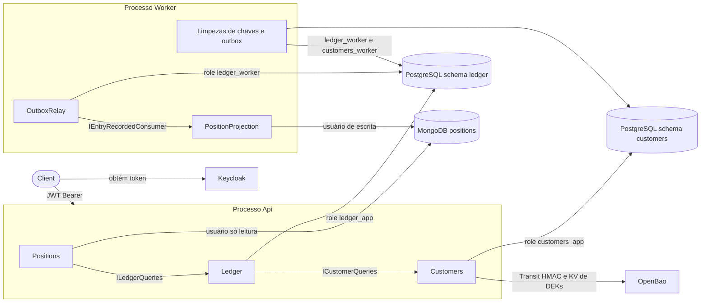
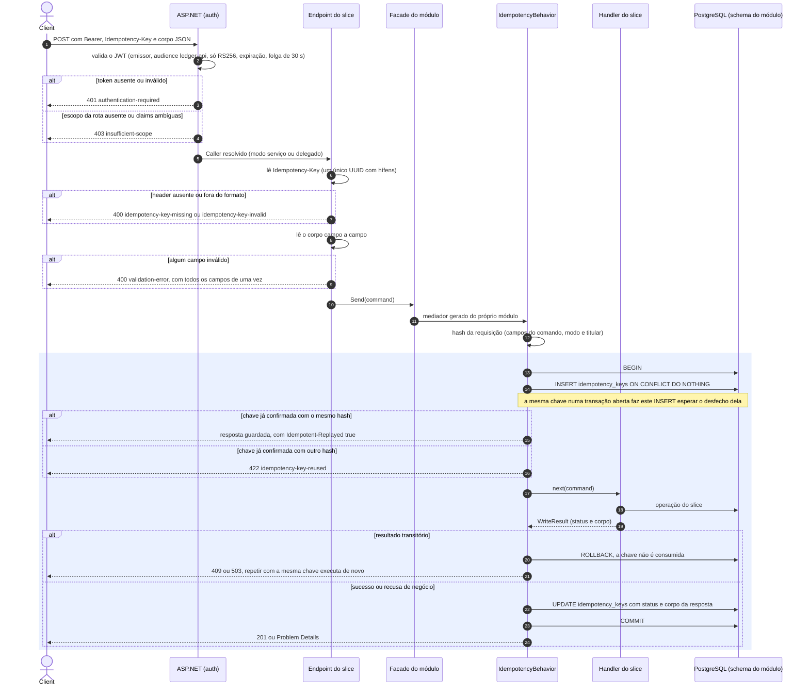

# Arquitetura: fluxos

Cada funcionalidade é mostrada como um diagrama de sequência, escrito a partir do código. O código
prevalece: um diagrama que diverge dele está desatualizado.

| Documento | Conteúdo |
|-----------|----------|
| Este arquivo | Legenda, mapa dos processos e o pipeline comum a toda escrita `POST` |
| [fluxos-ledger.md](fluxos-ledger.md) | Abertura de conta, crédito e débito, estorno, troca de limite, relay do outbox, projeção, saldo e extrato |
| [fluxos-customers.md](fluxos-customers.md) | Cadastro de cliente, leitura mascarada e leitura dos dados pessoais completos |

## Legenda

| Elemento | Significado |
|----------|-------------|
| Seta cheia `->>` | Chamada síncrona |
| Seta tracejada `-->>` | Resposta, ou entrega assíncrona entre processos |
| Bloco colorido (`rect`) | Fronteira de uma transação do PostgreSQL: tudo dentro confirma ou desfaz junto |
| `alt` | Caminho de recusa, com o status HTTP e o `type` do Problem Details |
| `Note` | A regra que o passo aplica e o ADR que a decide |

## Mapa dos processos

- Módulos só se falam pelos contratos públicos (`*.Contracts`), nunca pelas tabelas uns dos outros
  (ADR-0031). Cada módulo tem schema e role próprios (ADR-0038).
- A Api escreve e lê. O Worker entrega o outbox, projeta no MongoDB e apaga chaves e eventos
  vencidos (ADR-0009, ADR-0035).

## Pipeline comum de escrita (`POST`)

Todo `POST` do Ledger e de Customers passa por este caminho antes do handler do slice. Os diagramas
dos módulos começam onde este termina: no `Handler`.

| Etapa | Código | Decisão |
|-------|--------|---------|
| JWT, escopo e fallback que fecha rota sem política | [IdentityExtensions.cs](../../src/BuildingBlocks/Identity/IdentityExtensions.cs) | ADR-0012, ADR-0013 |
| Modo serviço ou delegado a partir das claims | [Caller.cs](../../src/BuildingBlocks/Identity/Caller.cs) | ADR-0013 |
| Leitura do header | [IdempotencyKeyHeader.cs](../../src/BuildingBlocks/Idempotency/IdempotencyKeyHeader.cs) | ADR-0037 |
| Campos que entram no hash | [RequestFields.cs](../../src/BuildingBlocks/Idempotency/RequestFields.cs) | ADR-0037 |
| Facade que despacha pelo mediador do módulo | [LedgerCommands.cs](../../src/Modules/Ledger/Ledger/Features/LedgerCommands.cs), [CustomersCommands.cs](../../src/Modules/Customers/Customers/Features/CustomersCommands.cs) | ADR-0036 |
| Reserva da chave, replay, commit ou rollback | [IdempotentExecution.cs](../../src/BuildingBlocks/Idempotency/IdempotentExecution.cs) | ADR-0037 |
| Resposta HTTP e header de replay | [WriteResult.cs](../../src/BuildingBlocks/Idempotency/WriteResult.cs) | ADR-0037, ADR-0039 |

Diferenças por módulo:

| | Ledger | Customers |
|---|--------|-----------|
| Hash da requisição | SHA-256 local: valores financeiros, sem dado pessoal | HMAC no Transit do OpenBao, antes do `BEGIN`: o corpo tem CPF |
| Abertura da transação | `SET LOCAL lock_timeout = '2s'` | Padrão |
| Falha transitória | Lock esgotado: `409 concurrency-timeout` | Cofre fora: `503 personal-data-unavailable` com `Retry-After: 5` |
