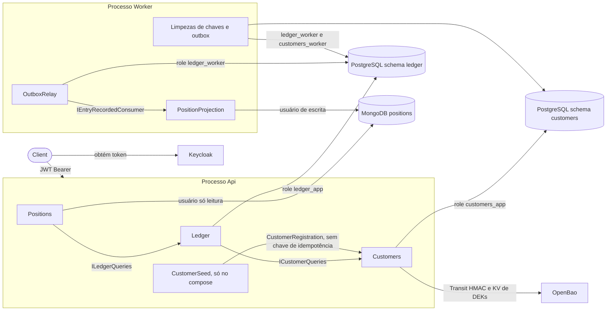

# Arquitetura: fluxos

Cada rota e cada rotina em segundo plano é mostrada como um diagrama de sequência, ou em passos
numerados quando não tem desvio, escrito a partir do código. O código prevalece: um fluxo que
diverge dele está desatualizado.

| Documento | Conteúdo |
|-----------|----------|
| Este arquivo | Legenda, mapa dos processos e o pipeline comum a toda escrita `POST` |
| [fluxos-ledger.md](fluxos-ledger.md) | Abertura de conta, crédito e débito, estorno, troca de limite, relay do outbox, projeção, saldo e extrato |
| [fluxos-customers.md](fluxos-customers.md) | Cadastro de cliente, leitura mascarada e leitura dos dados pessoais completos, acesso ao OpenBao, clientes de desenvolvimento e limpeza |

## Legenda

| Elemento | Significado |
|----------|-------------|
| Seta cheia `->>` | Chamada síncrona |
| Seta tracejada `-->>` | Resposta, ou entrega assíncrona entre processos |
| Bloco colorido (`rect`) | Fronteira de uma transação do PostgreSQL: tudo dentro confirma ou desfaz junto; cores diferentes, transações diferentes |
| `alt` | Caminho alternativo: recusa, com o status HTTP e o `type` do Problem Details, ou desvio interno de uma rotina |
| `opt` | Passo que só acontece sob a condição indicada |
| `Note` | A regra que o passo aplica e o ADR que a decide |

## Mapa dos processos



- Módulos só se falam pelos contratos públicos (`*.Contracts`), nunca pelas tabelas uns dos outros
  (ADR-0031). Cada módulo tem schema e role próprios (ADR-0043).
- A Api escreve e lê. O Worker entrega o outbox, projeta no MongoDB e apaga chaves e eventos
  vencidos (ADR-0009, ADR-0035).

## Pipeline comum de escrita (`POST`)

Todo `POST` do Ledger e de Customers passa por este caminho antes do handler do slice. Os diagramas
dos módulos começam onde este termina: no `Handler`. A autenticação e o escopo do início valem para
toda rota `/v1`, também `GET` e `PUT`: `401 authentication-required` e `403 insufficient-scope`.

Toda rota de escrita, e a leitura dos dados pessoais completos, é auditada (ADR-0041): o
`AuditMiddleware`, entre o tratador de exceção e a autenticação, abre um registro pendente com a
operação, o recurso e o `traceId`, e cada requisição deixa exatamente uma linha em
`<schema>.audit_events`. A escrita confirmada grava a linha na própria transação; qualquer outro
desfecho, o middleware grava no fim.

```mermaid
sequenceDiagram
  autonumber
  actor C as Client
  participant AU as AuditMiddleware
  participant MW as ASP.NET (auth)
  participant E as Endpoint do slice
  participant F as Facade do módulo
  participant B as IdempotencyBehavior
  participant H as Handler do slice
  participant DB as PostgreSQL (schema do módulo)

  C->>AU: POST com Bearer, Idempotency-Key e corpo JSON
  AU->>AU: rota auditada: abre o registro pendente (operação, recurso, traceId)
  AU->>MW: segue o pipeline
  MW->>MW: valida o JWT (emissor, audience ledger-api, só RS256, expiração, folga de 30 s)
  alt token ausente ou inválido
    MW-->>AU: 401 authentication-required
  else escopo da rota ausente, ou claims que não resolvem um chamador
    MW-->>AU: 403 insufficient-scope
  end
  MW->>E: Caller resolvido (modo serviço ou delegado)
  E->>E: lê Idempotency-Key (um único UUID com hífens)
  alt header ausente ou fora do formato
    E-->>AU: 400 idempotency-key-missing ou idempotency-key-invalid
  end
  E->>E: lê o corpo campo a campo
  alt algum campo inválido
    E-->>AU: 400 validation-error, com todos os campos de uma vez
  end
  E->>F: Send(command)
  F->>B: mediador gerado do próprio módulo
  B->>B: hash da requisição (campos do comando, modo e titular)
  rect rgba(80, 140, 255, 0.12)
    B->>DB: BEGIN
    B->>DB: INSERT idempotency_keys ON CONFLICT DO NOTHING
    Note over B,DB: a mesma chave numa transação aberta faz este INSERT esperar o desfecho dela. No Ledger, a espera é limitada pelo lock_timeout de 2 s e vira 409 concurrency-timeout (ADR-0021, ADR-0037)
    alt chave já confirmada com o mesmo hash
      B-->>E: resposta guardada, marcada como replay, com o recurso dela para o registro
    else chave já confirmada com outro hash
      B-->>E: 422 idempotency-key-reused
    end
    B->>H: next(command)
    H->>DB: operação do slice
    H-->>B: WriteResult (status e corpo)
    alt resultado transitório
      B->>DB: ROLLBACK, a chave não é consumida
      B-->>E: 409 ou 503, repetir com a mesma chave executa de novo
    else sucesso
      B->>DB: INSERT audit_events com o status (201) e o recurso
      B->>DB: UPDATE idempotency_keys com status e corpo da resposta
      B->>DB: COMMIT, e o registro fica gravado
      B-->>E: 201
    else recusa de negócio
      B->>DB: UPDATE idempotency_keys com status e corpo da resposta
      B->>DB: COMMIT
      B-->>E: Problem Details
    end
  end
  Note over B,DB: o INSERT da auditoria falhou: a exceção desfaz a escrita e a chave, e a resposta é 500 internal-error (ADR-0041)
  E-->>AU: WriteResult como resposta HTTP, com Idempotent-Replayed true no replay
  opt nada gravou o registro: recusa, repetição, transitório, 401, 403, exceção (500) ou cliente que desistiu (499)
    rect rgba(80, 200, 120, 0.12)
      AU->>DB: INSERT audit_events com o status, em escopo e transação próprios
    end
    Note over AU,DB: falhou: log de erro com a operação, o status e o traceId; a resposta já decidida não muda (ADR-0041)
  end
  AU-->>C: resposta
```

| Etapa | Código | Decisão |
|-------|--------|---------|
| Rota auditada, registro pendente e gravação do desfecho | [AuditedRoute.cs](../../src/BuildingBlocks/Audit/AuditedRoute.cs), [AuditMiddleware.cs](../../src/BuildingBlocks/Audit/AuditMiddleware.cs), [AuditEvent.cs](../../src/BuildingBlocks/Audit/AuditEvent.cs) | ADR-0041 |
| Ordem do middleware no pipeline | [Program.cs da Api](../../src/Hosts/Api/Program.cs) | ADR-0041, ADR-0042 |
| JWT, escopo e fallback que fecha rota sem política | [IdentityExtensions.cs](../../src/BuildingBlocks/Identity/IdentityExtensions.cs) | ADR-0012, ADR-0013 |
| Modo serviço ou delegado a partir das claims | [Caller.cs](../../src/BuildingBlocks/Identity/Caller.cs) | ADR-0013 |
| Leitura do header | [IdempotencyKeyHeader.cs](../../src/BuildingBlocks/Idempotency/IdempotencyKeyHeader.cs) | ADR-0037 |
| Campos que entram no hash | [RequestFields.cs](../../src/BuildingBlocks/Idempotency/RequestFields.cs) | ADR-0037 |
| Facade que despacha pelo mediador do módulo | [LedgerCommands.cs](../../src/Modules/Ledger/Ledger/Features/LedgerCommands.cs), [CustomersCommands.cs](../../src/Modules/Customers/Customers/Features/CustomersCommands.cs) | ADR-0036 |
| Reserva da chave, replay, registro da escrita confirmada, commit ou rollback | [IdempotentExecution.cs](../../src/BuildingBlocks/Idempotency/IdempotentExecution.cs) | ADR-0037, ADR-0041 |
| Resposta HTTP e header de replay | [WriteResult.cs](../../src/BuildingBlocks/Idempotency/WriteResult.cs) | ADR-0037, ADR-0042 |
| Ledger: hash SHA-256, transação com `lock_timeout` e lock esgotado | [IdempotencyBehavior.cs](../../src/Modules/Ledger/Ledger/Infrastructure/Idempotency/IdempotencyBehavior.cs), [RequestHash.cs](../../src/Modules/Ledger/Ledger/Infrastructure/Idempotency/RequestHash.cs), [AccountWrites.cs](../../src/Modules/Ledger/Ledger/Infrastructure/Persistence/AccountWrites.cs) | ADR-0005, ADR-0021, ADR-0037 |
| Customers: hash no Transit e cofre fora | [IdempotencyBehavior.cs](../../src/Modules/Customers/Customers/Infrastructure/Idempotency/IdempotencyBehavior.cs), [CustomersProblems.cs](../../src/Modules/Customers/Customers/Features/CustomersProblems.cs) | ADR-0016, ADR-0037 |
| Trilha de cada módulo, só com `INSERT` | [LedgerAudit.cs](../../src/Modules/Ledger/Ledger/Features/LedgerAudit.cs), [CustomersAudit.cs](../../src/Modules/Customers/Customers/Features/CustomersAudit.cs), migrações `AuditEvents` | ADR-0041, ADR-0043 |

Diferenças por módulo:

| | Ledger | Customers |
|---|--------|-----------|
| Hash da requisição | SHA-256 local: valores financeiros, sem dado pessoal | HMAC no Transit do OpenBao, antes do `BEGIN`: o corpo tem CPF |
| Abertura da transação | `SET LOCAL lock_timeout = '2s'` | Padrão |
| Trilha de auditoria | `ledger.audit_events`, pela `ledger_app` | `customers.audit_events`, pela `customers_app` |
| Falha transitória | Lock esgotado: `409 concurrency-timeout` | Cofre fora: `503 personal-data-unavailable` com `Retry-After: 5` |

## Rotas fora dos módulos

Rotas sem desvio por requisição, em passos numerados:

1. `GET /health/live`, na Api e no Worker, anônima: responde `200` sem consultar nenhuma dependência,
   só para dizer que o processo responde.
2. `/openapi/v1.json` e a referência navegável do Scalar, anônimas, são mapeadas na subida só em
   Development. Fora dele não existem, e a requisição cai na política padrão: `401` ou `403`.

| Rota | Código | Decisão |
|------|--------|---------|
| Liveness | [Program.cs da Api](../../src/Hosts/Api/Program.cs), [Program.cs do Worker](../../src/Hosts/Worker/Program.cs) | ADR-0021 |
| Contrato navegável | [Program.cs da Api](../../src/Hosts/Api/Program.cs) | ADR-0042 |
