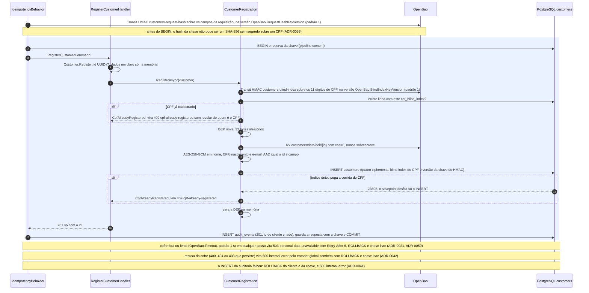
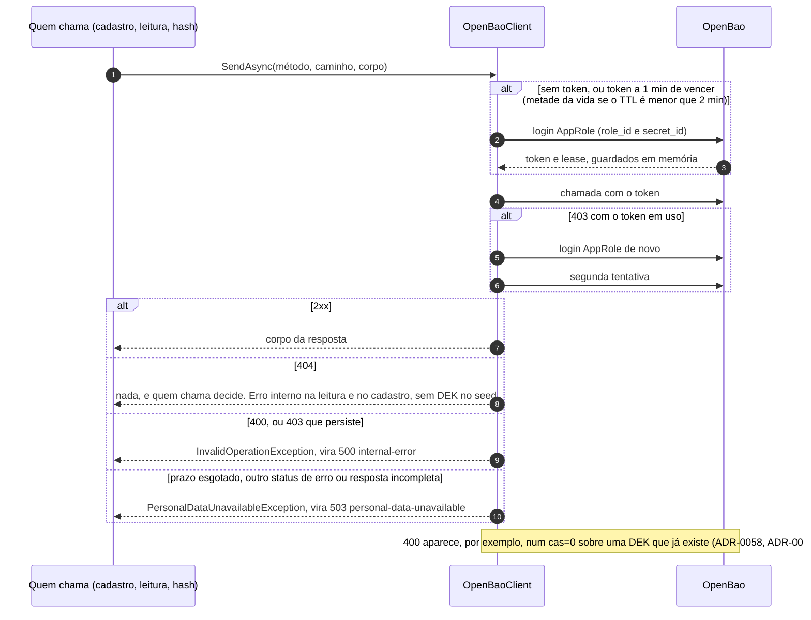
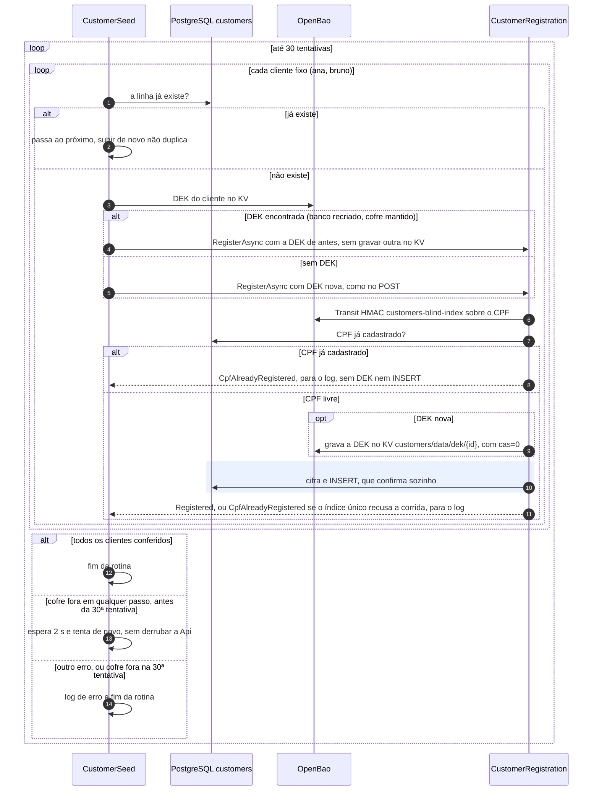
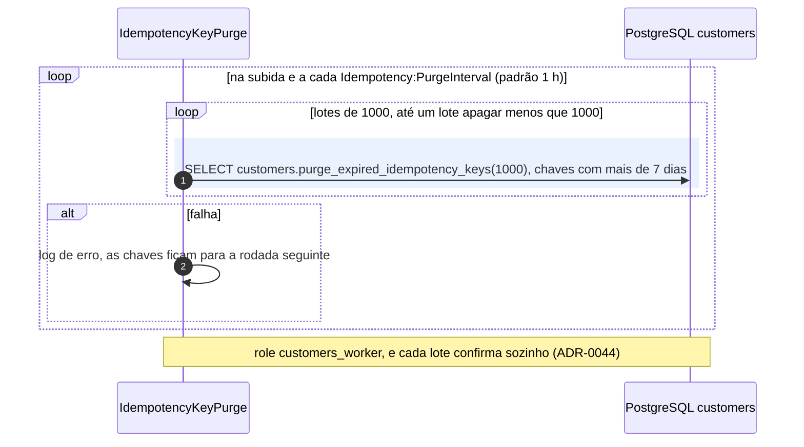

# Fluxos de Customers

Customers guarda os dados pessoais cifrados campo a campo, cada cliente com a própria chave (DEK) no
OpenBao (ADR-0058). O PostgreSQL só tem ciphertext e o blind index do CPF. O `POST` passa antes pelo
[pipeline comum de escrita](README.md#pipeline-comum-de-escrita-post).

## Cadastro de cliente

`POST /v1/customers`, escopo `customers.write`. O endpoint valida e normaliza os quatro campos antes
do comando: nome com 1 a 150 caracteres, CPF válido com ou sem pontuação, nascimento em `yyyy-MM-dd`,
a partir de 1900-01-01, de alguém com 18 anos ou mais na data de hoje em UTC, e-mail com uma `@` e
domínio com ponto, até 254 caracteres. As mensagens de erro nunca repetem o valor recebido.



Cada requisição deixa uma linha `register-customer` em `customers.audit_events` (ADR-0041): o `201`
na transação do cadastro; `400`, `409`, `413`, `422`, `503`, repetição, `401`, `403`, `500` e `499` no fim
da requisição, pelo `AuditMiddleware` do pipeline comum. O `resource_id` vem do `201` com o id do
cliente, do handler ou guardado com a chave; o `500` de um cadastro desfeito sai sem ele.

| Etapa | Código | Decisão |
|-------|--------|---------|
| Endpoint, validação dos campos e operação auditada | [RegisterCustomer.cs](../../src/Modules/Customers/Customers/Features/RegisterCustomer/RegisterCustomer.cs), [CustomersInput.cs](../../src/Modules/Customers/Customers/Features/CustomersInput.cs), [CustomersAudit.cs](../../src/Modules/Customers/Customers/Features/CustomersAudit.cs) | ADR-0030, ADR-0041, ADR-0042 |
| Commit até o fim, mesmo com o cliente que desiste | [IdempotentExecution.cs](../../src/BuildingBlocks/Idempotency/IdempotentExecution.cs) | ADR-0059, ADR-0041 |
| Hash da requisição no Transit e tratamento do cofre fora, com o `Retry-After` do `503` | [IdempotencyBehavior.cs](../../src/Modules/Customers/Customers/Infrastructure/Idempotency/IdempotencyBehavior.cs), [CustomersProblems.cs](../../src/Modules/Customers/Customers/Features/CustomersProblems.cs), [WriteResult.cs](../../src/BuildingBlocks/Idempotency/WriteResult.cs) | ADR-0059, ADR-0021 |
| Blind index, DEK e INSERT | [CustomerRegistration.cs](../../src/Modules/Customers/Customers/Infrastructure/Persistence/CustomerRegistration.cs) | ADR-0058 |
| Cifra campo a campo | [CustomerSeal.cs](../../src/Modules/Customers/Customers/Infrastructure/Persistence/CustomerSeal.cs), [FieldCipher.cs](../../src/Modules/Customers/Customers/Infrastructure/Crypto/FieldCipher.cs) | ADR-0058 |
| HMAC no Transit, na versão fixa da chave, e DEK no KV | [IBlindIndexer.cs](../../src/Modules/Customers/Customers/Infrastructure/Vault/IBlindIndexer.cs), [IKeyStore.cs](../../src/Modules/Customers/Customers/Infrastructure/Vault/IKeyStore.cs) | ADR-0058, ADR-0059 |

A versão de cada chave do Transit é fixa e vai em todo pedido de HMAC (`key_version`). Depois de um
`rotate`, o mesmo CPF continua com o mesmo blind index, e a mesma requisição com o mesmo hash. Sem ela,
o Transit usaria a versão mais nova, e o CPF entraria de novo ou a repetição viraria `422`.

A DEK vai para o cofre antes da linha. Uma falha entre os dois deixa no máximo uma DEK sem linha,
nunca uma linha sem chave. A resposta guardada com a chave de idempotência tem só o id, sem dado
pessoal (ADR-0059).

Formato de cada campo cifrado: `0x01 | nonce (12 bytes) | ciphertext | tag (16 bytes)`. A AAD
`{customerId}|{campo}` impede que um ciphertext copiado de outro cliente ou de outro campo decifre.

## Leitura mascarada e leitura completa

Duas rotas sobre o mesmo `CustomerReader`:

| Rota | Escopo | Resposta |
|------|--------|----------|
| `GET /v1/customers/{id}` | `customers.read` | Mascarada: `Ana M. S.`, `***.982.247-**`, `****-**-15`, `a***@dominio`, e uma linha em `customers.audit_events` por acesso |
| `GET /v1/customers/{id}/personal-data` | `customers.pii.read` | Completa, com CPF formatado, e uma linha em `customers.audit_events` por acesso |

As duas são rotas auditadas (ADR-0013, ADR-0041): o `AuditMiddleware` do
[pipeline comum](README.md#pipeline-comum-de-escrita-post) abre o registro antes da autenticação,
`read-customer` na mascarada e `read-personal-data` na completa. A mascarada também decifra os dados,
e todo acesso fica na trilha.

```mermaid
sequenceDiagram
  autonumber
  actor C as Client
  participant AU as AuditMiddleware
  participant AZ as ASP.NET (auth)
  participant E as Endpoint
  participant RD as CustomerReader
  participant DB as PostgreSQL customers
  participant K as CustomerKeys (cache de DEK)
  participant V as OpenBao

  C->>AU: GET cliente com Bearer
  AU->>AU: abre o registro pendente (read-customer ou read-personal-data, id da rota, traceId)
  AU->>AZ: segue o pipeline
  alt token ausente ou inválido
    AZ-->>AU: 401 authentication-required
  else escopo da rota ausente, ou claims que não resolvem um chamador
    AZ-->>AU: 403 insufficient-scope
  end
  alt corpo acima de 16 384 bytes
    AZ-->>AU: 413 payload-too-large, pelo limite do pipeline comum (ADR-0047)
  end
  AZ->>E: principal com o chamador resolvido
  E->>RD: ReadAsync(id, user.ResolvedCaller())
  alt id fora do formato, ou delegado lendo outro cliente
    RD-->>E: 404 customer-not-found, sem tocar o banco
  end
  RD->>DB: SELECT linha por id
  alt linha inexistente
    RD-->>E: 404 customer-not-found
  end
  RD->>K: DEK do cliente
  alt DEK no cache, lida do cofre há menos de 5 min
    K-->>RD: cópia da DEK
  else fora do cache
    K->>V: KV customers/data/dek/{id}
    alt cofre fora ou lento
      V-->>K: falha
      K-->>RD: PersonalDataUnavailableException
      RD-->>E: 503 personal-data-unavailable com Retry-After 5
    else DEK ausente, fora do formato ou recusa da política
      V-->>K: 404, 400 ou 403 que persiste, ou DEK fora do formato
      K-->>RD: exceção
      RD-->>AU: a exceção sobe e vira 500 internal-error pelo tratador global
    end
    K-->>RD: DEK, que entra no cache
  end
  RD->>RD: decifra os quatro campos com a AAD de cada um
  alt algum campo não decifra
    RD-->>E: 500 internal-error, log só com id e nome do campo
  end
  RD->>RD: zera a DEK na memória
  RD-->>E: dados
  opt rota personal-data, com os dados
    rect rgba(240, 160, 60, 0.12)
      E->>DB: INSERT audit_events (200), antes de devolver os dados, que confirma sozinho
    end
    Note over E,DB: falhou: a exceção sobe, e a resposta é 500 internal-error sem dado pessoal (ADR-0041)
  end
  E-->>AU: o status. No 200, dados completos na rota personal-data e mascarados na outra
  opt registro ainda não gravado: na mascarada, todo desfecho; na personal-data, 401, 403, 413, 404, 503, 500 ou 499 do cliente que desistiu antes da resposta
    rect rgba(80, 200, 120, 0.12)
      AU->>DB: INSERT audit_events com o status, em escopo e transação próprios
    end
    Note over AU,DB: falhou: log de erro com a operação, o status e o traceId; a resposta já decidida não muda (ADR-0041, ADR-0042)
  end
  AU-->>C: resposta
```

| Etapa | Código | Decisão |
|-------|--------|---------|
| Endpoints, leitor e registro do `200` antes dos dados | [ReadCustomer.cs](../../src/Modules/Customers/Customers/Features/ReadCustomer/ReadCustomer.cs) | ADR-0013, ADR-0041, ADR-0042 |
| Limite do corpo, antes do endpoint | [RequestBodyLimit.cs](../../src/BuildingBlocks/Http/RequestBodyLimit.cs) | ADR-0047 |
| Registro pendente e gravação dos demais desfechos | [AuditMiddleware.cs](../../src/BuildingBlocks/Audit/AuditMiddleware.cs), [AuditEvent.cs](../../src/BuildingBlocks/Audit/AuditEvent.cs), [CustomersAudit.cs](../../src/Modules/Customers/Customers/Features/CustomersAudit.cs) | ADR-0041 |
| Decifragem dos campos com a AAD e DEK lida do KV | [CustomerSeal.cs](../../src/Modules/Customers/Customers/Infrastructure/Persistence/CustomerSeal.cs), [FieldCipher.cs](../../src/Modules/Customers/Customers/Infrastructure/Crypto/FieldCipher.cs), [IKeyStore.cs](../../src/Modules/Customers/Customers/Infrastructure/Vault/IKeyStore.cs) | ADR-0058 |
| Cache de DEK com prazo contado da leitura no cofre | [DekCache.cs](../../src/Modules/Customers/Customers/Infrastructure/Vault/DekCache.cs) | ADR-0058 |
| Máscaras | [CustomerMask.cs](../../src/Modules/Customers/Customers/Domain/CustomerMask.cs) | ADR-0042 |
| Catálogo de recusas | [CustomersProblems.cs](../../src/Modules/Customers/Customers/Features/CustomersProblems.cs) | ADR-0042 |

## Acesso ao OpenBao

Um cliente HTTP único para a Api, com prazo por chamada de `OpenBao:Timeout` (padrão 1 s). Endereço,
credenciais, prazo e versões das chaves do Transit são lidos na subida, e a Api não sobe (ADR-0058)
com endereço ou credencial ausente, endereço que não é URI absoluta ou sem `https` fora de Development,
prazo fora de 1 ms a 1 min, ou versão de chave que não é um inteiro a partir de 1.



| Etapa | Código | Decisão |
|-------|--------|---------|
| Configuração lida na subida, login, renovação, nova tentativa e tradução dos status | [OpenBaoClient.cs](../../src/Modules/Customers/Customers/Infrastructure/Vault/OpenBaoClient.cs), [CustomersModule.cs](../../src/Modules/Customers/Customers/CustomersModule.cs), [TimeSpanSetting.cs](../../src/BuildingBlocks/Configuration/TimeSpanSetting.cs) | ADR-0058, ADR-0021 |
| DEK ausente como erro interno | [IKeyStore.cs](../../src/Modules/Customers/Customers/Infrastructure/Vault/IKeyStore.cs), [IBlindIndexer.cs](../../src/Modules/Customers/Customers/Infrastructure/Vault/IBlindIndexer.cs) | ADR-0058, ADR-0042 |

O Ledger confirma que um cliente existe por `ICustomerQueries.ExistsAsync`, que consulta só o
PostgreSQL. Com o cofre fora, a abertura de conta continua funcionando (ADR-0058).

## Clientes de desenvolvimento (Api)

Rotina da Api, ligada só quando `Customers:Seed:Enabled` é verdadeiro, em Development (o compose liga). Cadastra os
clientes dos usuários `ana` e `bruno` do realm local, com dados fictícios e os mesmos `customer_id`.
Fora de Development, a configuração ligada recusa a subida: a Api não sobe, e a saída cita
`Customers:Seed:Enabled` ([CustomersModule.cs](../../src/Modules/Customers/Customers/CustomersModule.cs), ADR-0058).



| Etapa | Código | Decisão |
|-------|--------|---------|
| Tentativas, clientes fixos e DEK reaproveitada | [CustomerSeed.cs](../../src/Modules/Customers/Customers/Infrastructure/Seed/CustomerSeed.cs) | ADR-0058 |
| Cadastro sem chave de idempotência | [CustomerRegistration.cs](../../src/Modules/Customers/Customers/Infrastructure/Persistence/CustomerRegistration.cs) | ADR-0058 |

## Limpeza (Worker)



| Etapa | Código | Decisão |
|-------|--------|---------|
| Agenda e chaves vencidas | [IdempotencyKeyPurge.cs](../../src/Modules/Customers/Customers/Infrastructure/Idempotency/IdempotencyKeyPurge.cs) | ADR-0059, ADR-0044 |
| Lotes que confirmam sozinhos | [BatchedPurge.cs](../../src/BuildingBlocks/Persistence/BatchedPurge.cs) | ADR-0044 |
| Função de limpeza e prazo de 7 dias | [Migração de clientes e chaves](../../src/Modules/Customers/Customers/Infrastructure/Persistence/Migrations/20261101143504_CustomersAndIdempotencyKeys.cs) | ADR-0059, ADR-0044 |
