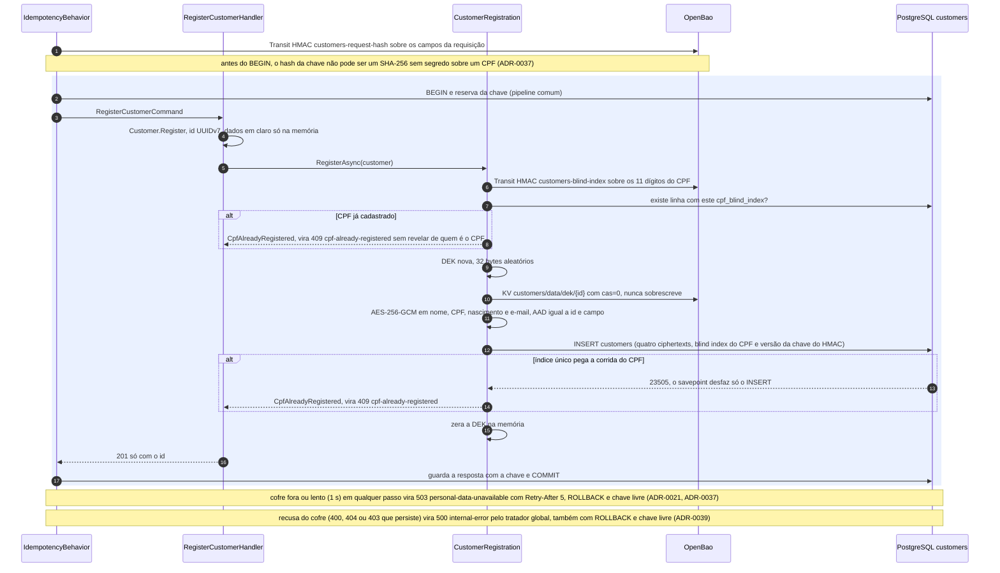
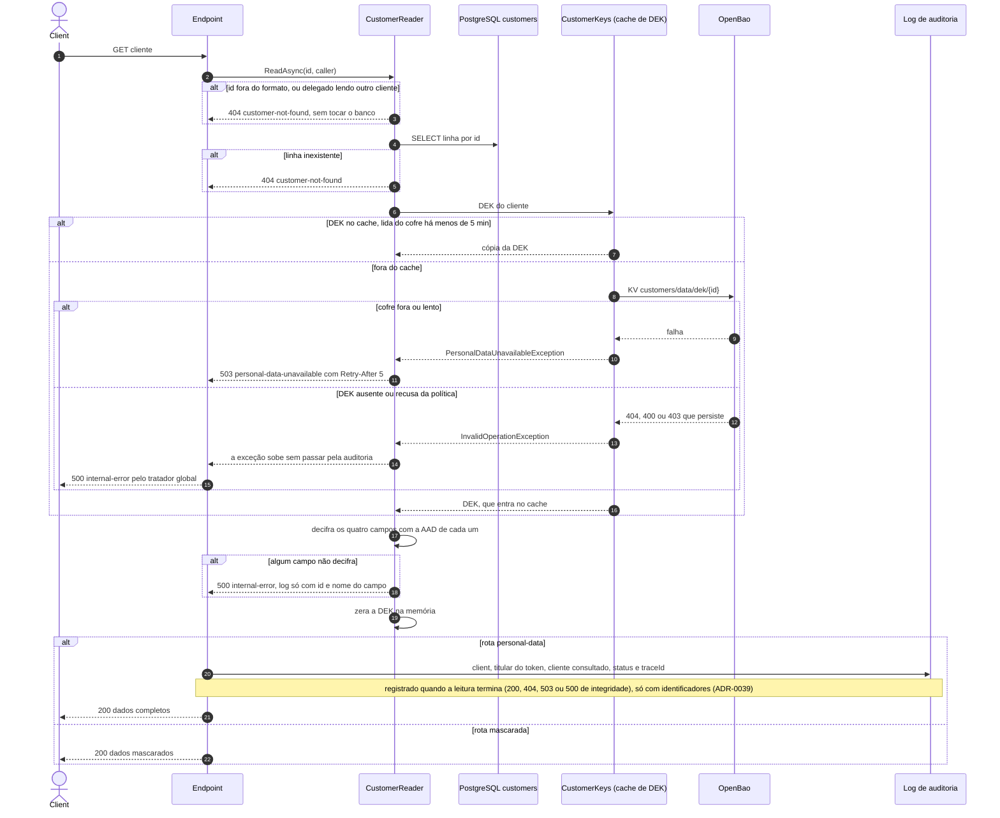
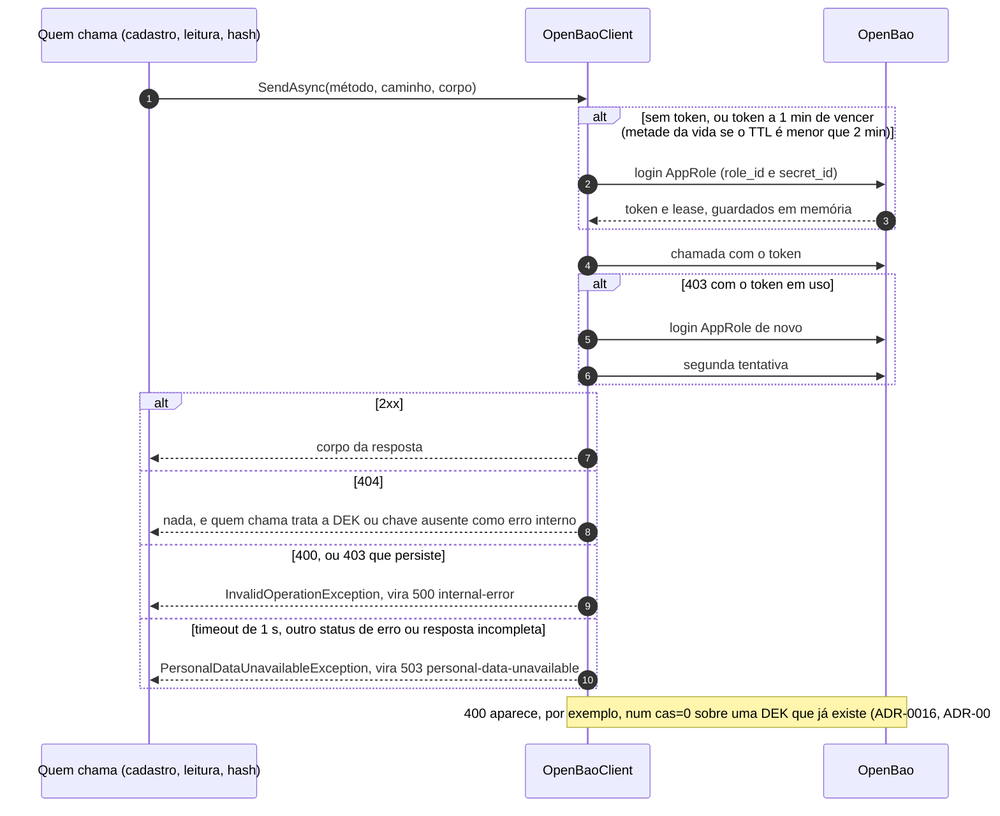
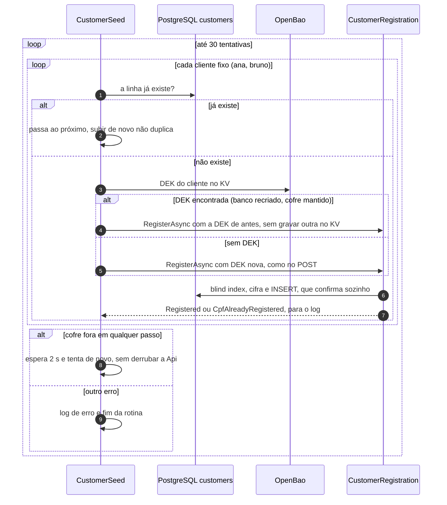
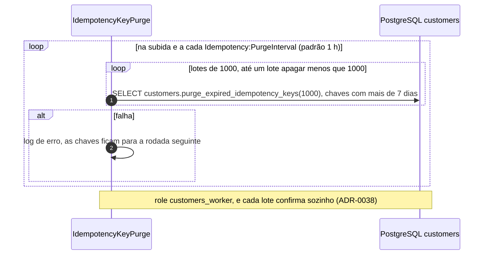

# Fluxos de Customers

Customers guarda os dados pessoais cifrados campo a campo, cada cliente com a própria chave (DEK) no
OpenBao (ADR-0016). O PostgreSQL só tem ciphertext e o blind index do CPF. O `POST` passa antes pelo
[pipeline comum de escrita](README.md#pipeline-comum-de-escrita-post).

## Cadastro de cliente

`POST /v1/customers`, escopo `customers.write`. O endpoint valida e normaliza os quatro campos antes
do comando: nome com 1 a 150 caracteres, CPF válido com ou sem pontuação, nascimento em `yyyy-MM-dd`,
a partir de 1900-01-01, de alguém com 18 anos ou mais na data de hoje em UTC, e-mail com uma `@` e
domínio com ponto, até 254 caracteres. As mensagens de erro nunca repetem o valor recebido.

| Etapa | Código | Decisão |
|-------|--------|---------|
| Endpoint e validação dos campos | [RegisterCustomer.cs](../../src/Modules/Customers/Customers/Features/RegisterCustomer/RegisterCustomer.cs), [CustomersInput.cs](../../src/Modules/Customers/Customers/Features/CustomersInput.cs) | ADR-0030, ADR-0039 |
| Hash da requisição no Transit e tratamento do cofre fora | [IdempotencyBehavior.cs](../../src/Modules/Customers/Customers/Infrastructure/Idempotency/IdempotencyBehavior.cs) | ADR-0037 |
| Blind index, DEK e INSERT | [CustomerRegistration.cs](../../src/Modules/Customers/Customers/Infrastructure/Persistence/CustomerRegistration.cs) | ADR-0016 |
| Cifra campo a campo | [CustomerSeal.cs](../../src/Modules/Customers/Customers/Infrastructure/Persistence/CustomerSeal.cs), [FieldCipher.cs](../../src/Modules/Customers/Customers/Infrastructure/Crypto/FieldCipher.cs) | ADR-0016 |
| HMAC no Transit e DEK no KV | [IBlindIndexer.cs](../../src/Modules/Customers/Customers/Infrastructure/Vault/IBlindIndexer.cs), [IKeyStore.cs](../../src/Modules/Customers/Customers/Infrastructure/Vault/IKeyStore.cs) | ADR-0016 |

A DEK vai para o cofre antes da linha. Uma falha entre os dois deixa no máximo uma DEK sem linha,
nunca uma linha sem chave. A resposta guardada com a chave de idempotência tem só o id, sem dado
pessoal (ADR-0037).

Formato de cada campo cifrado: `0x01 | nonce (12 bytes) | ciphertext | tag (16 bytes)`. A AAD
`{customerId}|{campo}` impede que um ciphertext copiado de outro cliente ou de outro campo decifre.

## Leitura mascarada e leitura completa

Duas rotas sobre o mesmo `CustomerReader`:

| Rota | Escopo | Resposta |
|------|--------|----------|
| `GET /v1/customers/{id}` | `customers.read` | Mascarada: `Ana M. S.`, `***.982.247-**`, `****-**-15`, `a***@dominio` |
| `GET /v1/customers/{id}/personal-data` | `customers.pii.read` | Completa, com CPF formatado, e um registro de auditoria por acesso |

| Etapa | Código | Decisão |
|-------|--------|---------|
| Endpoints, leitor e auditoria | [ReadCustomer.cs](../../src/Modules/Customers/Customers/Features/ReadCustomer/ReadCustomer.cs) | ADR-0013, ADR-0039 |
| Cache de DEK com prazo contado da leitura no cofre | [DekCache.cs](../../src/Modules/Customers/Customers/Infrastructure/Vault/DekCache.cs) | ADR-0016 |
| Máscaras | [CustomerMask.cs](../../src/Modules/Customers/Customers/Domain/CustomerMask.cs) | ADR-0039 |
| Catálogo de recusas | [CustomersProblems.cs](../../src/Modules/Customers/Customers/Features/CustomersProblems.cs) | ADR-0039 |

## Acesso ao OpenBao

Um cliente HTTP único para a Api, com timeout de 1 s por chamada. Endereço e credenciais são lidos
na subida: sem eles, a Api não sobe.

| Etapa | Código | Decisão |
|-------|--------|---------|
| Login, renovação, nova tentativa e tradução dos status | [OpenBaoClient.cs](../../src/Modules/Customers/Customers/Infrastructure/Vault/OpenBaoClient.cs) | ADR-0016, ADR-0021 |
| DEK ausente como erro interno | [IKeyStore.cs](../../src/Modules/Customers/Customers/Infrastructure/Vault/IKeyStore.cs), [IBlindIndexer.cs](../../src/Modules/Customers/Customers/Infrastructure/Vault/IBlindIndexer.cs) | ADR-0016, ADR-0039 |

O Ledger confirma que um cliente existe por `ICustomerQueries.ExistsAsync`, que consulta só o
PostgreSQL. Com o cofre fora, a abertura de conta continua funcionando (ADR-0016).

## Clientes de desenvolvimento (Api)

Rotina da Api, ligada só quando `Customers:Seed:Enabled` é verdadeiro (o compose liga). Cadastra os
clientes dos usuários `ana` e `bruno` do realm local, com dados fictícios e os mesmos `customer_id`.

| Etapa | Código | Decisão |
|-------|--------|---------|
| Tentativas, clientes fixos e DEK reaproveitada | [CustomerSeed.cs](../../src/Modules/Customers/Customers/Infrastructure/Seed/CustomerSeed.cs) | ADR-0016 |
| Cadastro sem chave de idempotência | [CustomerRegistration.cs](../../src/Modules/Customers/Customers/Infrastructure/Persistence/CustomerRegistration.cs) | ADR-0016 |

## Limpeza (Worker)

| Etapa | Código | Decisão |
|-------|--------|---------|
| Agenda e chaves vencidas | [IdempotencyKeyPurge.cs](../../src/Modules/Customers/Customers/Infrastructure/Idempotency/IdempotencyKeyPurge.cs) | ADR-0037, ADR-0038 |
| Lotes que confirmam sozinhos | [BatchedPurge.cs](../../src/BuildingBlocks/Persistence/BatchedPurge.cs) | ADR-0038 |
