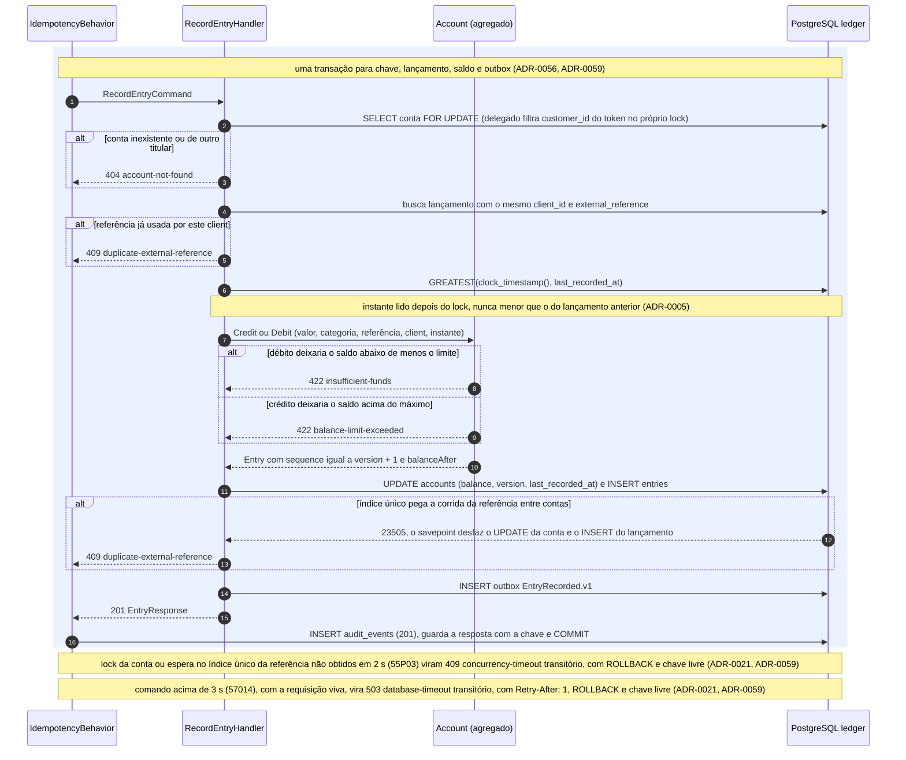
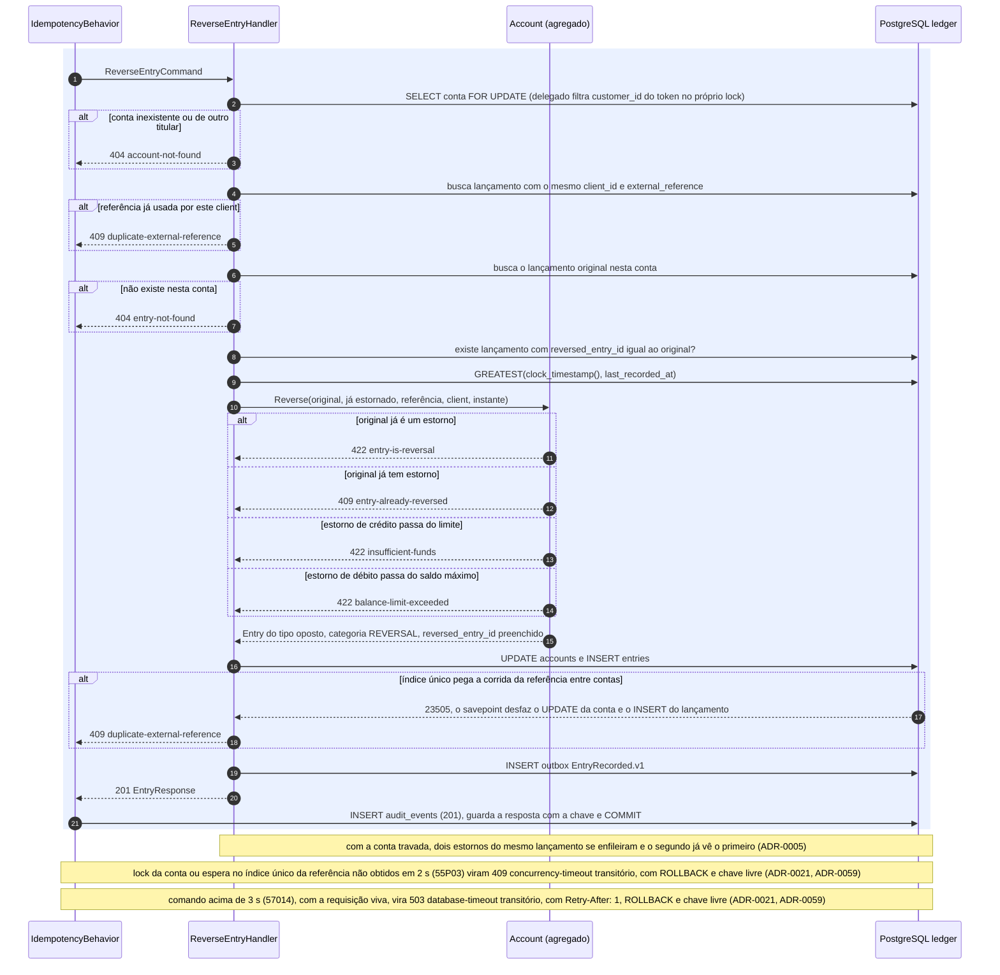
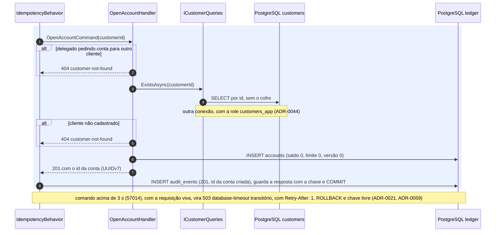
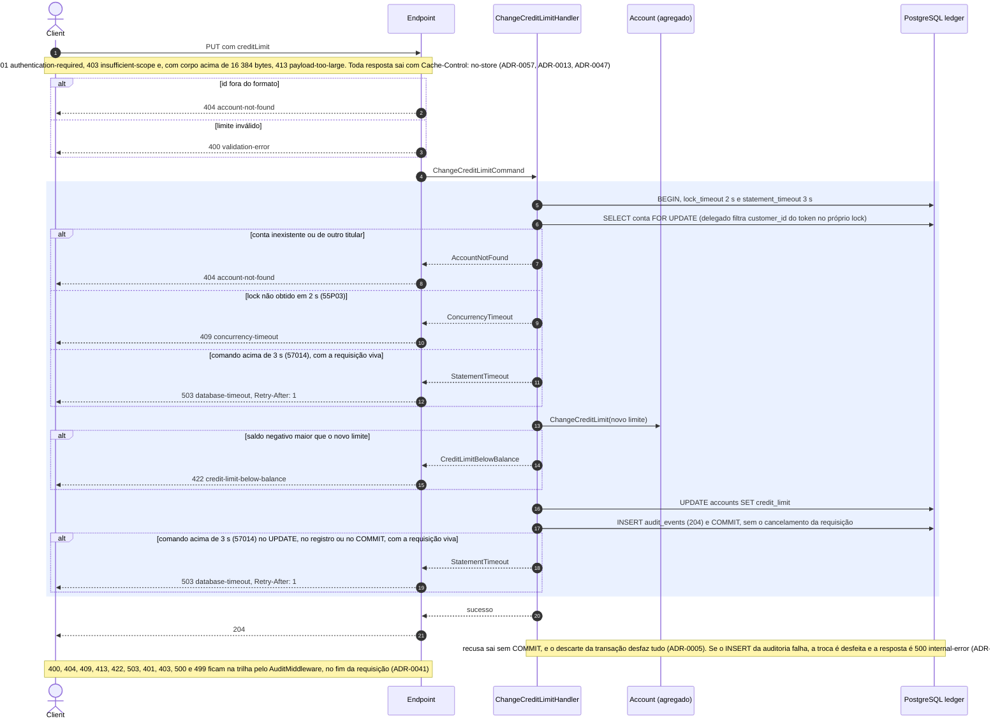
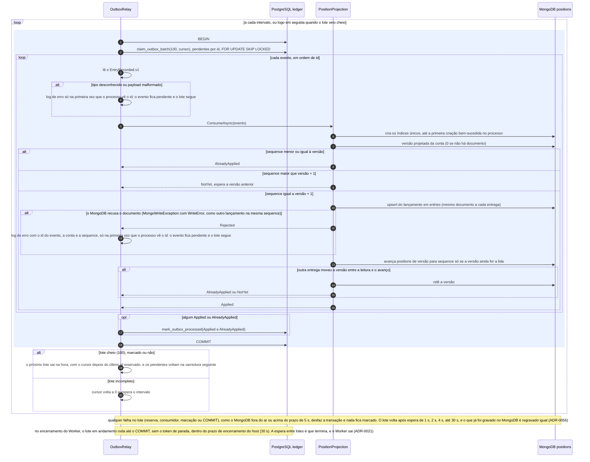
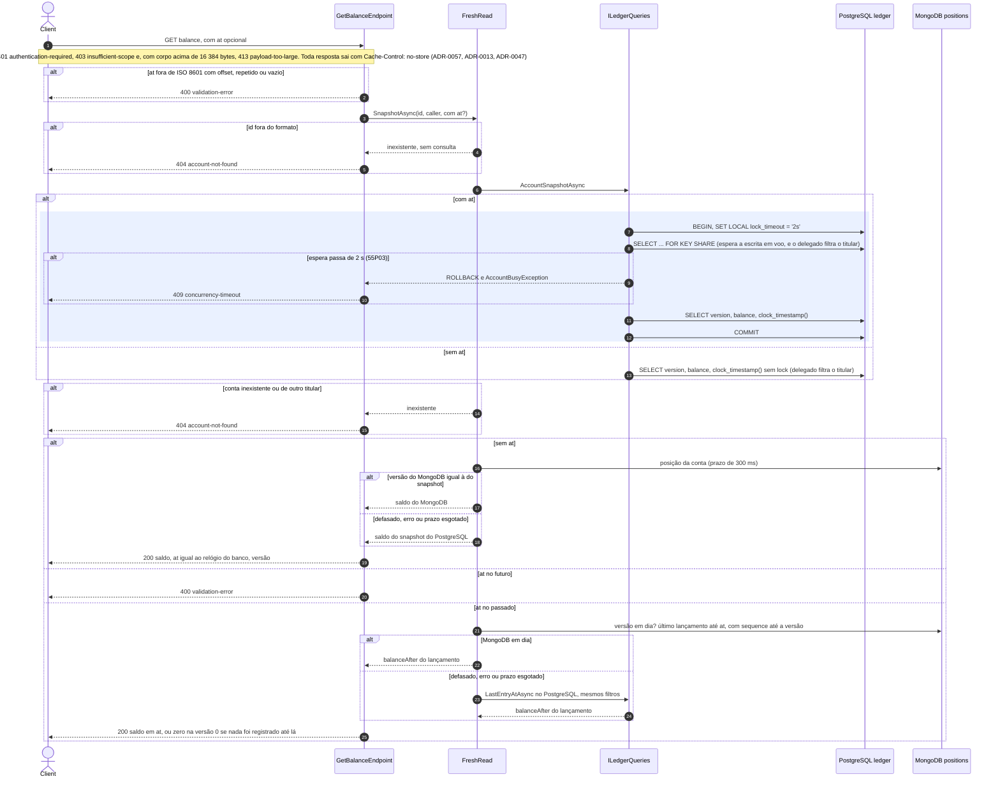
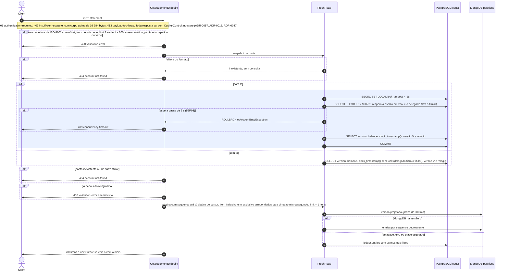
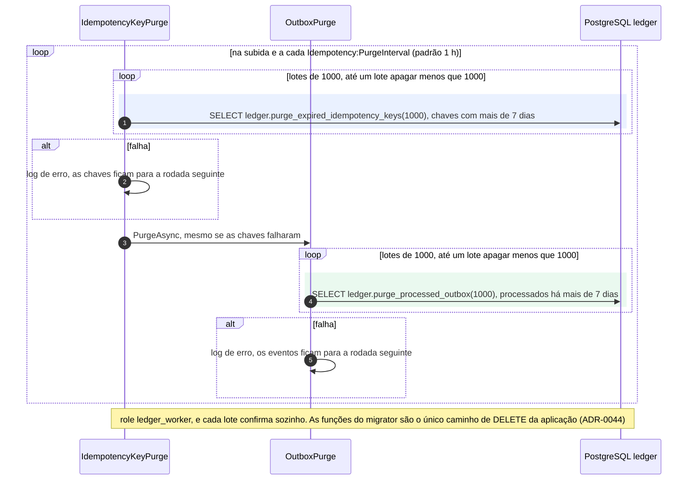

# Fluxos do Ledger e de Positions

Os `POST` passam antes pelo [pipeline comum de escrita](README.md#pipeline-comum-de-escrita-post):
autenticação, escopo, `Idempotency-Key`, validação do corpo e reserva da chave. Os diagramas dos
`POST` começam no `IdempotencyBehavior`, com a transação já aberta, `lock_timeout` de 2 s e
`statement_timeout` de 3 s. Toda
rota de escrita deixa uma linha em `ledger.audit_events` (ADR-0041): a escrita confirmada, na própria
transação; recusa, repetição, `409 concurrency-timeout`, `503 database-timeout`, `401`, `403`, `413`, `500` e `499`, no fim da
requisição, pelo `AuditMiddleware` do pipeline comum.

## Crédito e débito

`POST /v1/accounts/{id}/credits` (escopo `ledger.credits.write`) e
`POST /v1/accounts/{id}/debits` (escopo `ledger.debits.write`). As rotas e os escopos são separados:
quem só credita não consegue debitar (ADR-0042).

Id de conta fora do formato não chega ao comando: o endpoint responde `404 account-not-found` antes da
idempotência, sem guardar resposta, e a chave segue livre ([pipeline comum](README.md#pipeline-comum-de-escrita-post)).
O `404` de um id no formato, sem conta, é guardado com a chave, porque a conta pode passar a existir. O `409 duplicate-external-reference` leva `entryId` e `accountId` do
lançamento existente quando o chamador pode ver a conta dele (ADR-0013).

| Etapa | Código | Decisão |
|-------|--------|---------|
| Endpoint, leitura do corpo, envio do comando e operação auditada (`credit`, `debit`, recurso `account`) | [RecordEntry.cs](../../src/Modules/Ledger/Ledger/Features/RecordEntry/RecordEntry.cs), [LedgerAudit.cs](../../src/Modules/Ledger/Ledger/Features/LedgerAudit.cs) | ADR-0030, ADR-0041, ADR-0042 |
| Referência externa, outbox e recusa de duplicata | [EntryWrites.cs](../../src/Modules/Ledger/Ledger/Features/EntryWrites.cs) | ADR-0059 |
| Lock pessimista, prazos do lock e do comando, filtro do titular e instante de registro | [AccountWrites.cs](../../src/Modules/Ledger/Ledger/Infrastructure/Persistence/AccountWrites.cs), [LedgerProblems.cs](../../src/Modules/Ledger/Ledger/Features/LedgerProblems.cs) | ADR-0005, ADR-0013, ADR-0021 |
| Regras de saldo, limite e versão | [Account.cs](../../src/Modules/Ledger/Ledger/Domain/Account.cs) | ADR-0048, ADR-0049 |
| Payload do evento | [OutboxEvent.cs](../../src/Modules/Ledger/Ledger/Infrastructure/Outbox/OutboxEvent.cs) | ADR-0006, ADR-0056 |
| Catálogo de recusas | [LedgerProblems.cs](../../src/Modules/Ledger/Ledger/Features/LedgerProblems.cs), [ProblemResponses.cs](../../src/BuildingBlocks/Http/ProblemResponses.cs) | ADR-0042 |

## Estorno

`POST /v1/accounts/{id}/entries/{entryId}/reversal`, escopo `ledger.entries.reverse`. Mesmo caminho
do crédito e do débito: lock da conta, referência externa, outbox. Muda só a decisão no meio.

Id de conta ou `entryId` fora do formato não chega ao comando: o endpoint responde `404 account-not-found`
ou `404 entry-not-found` antes da idempotência, sem guardar resposta, e a chave segue livre.

| Etapa | Código | Decisão |
|-------|--------|---------|
| Endpoint, ids fora do formato, busca do original e operação auditada (`reverse-entry`, recurso `entry`: o lançamento estornado) | [ReverseEntry.cs](../../src/Modules/Ledger/Ledger/Features/ReverseEntry/ReverseEntry.cs) | ADR-0013, ADR-0041, ADR-0042 |
| Lock, referência externa e outbox, como no crédito | [EntryWrites.cs](../../src/Modules/Ledger/Ledger/Features/EntryWrites.cs), [AccountWrites.cs](../../src/Modules/Ledger/Ledger/Infrastructure/Persistence/AccountWrites.cs) | ADR-0005, ADR-0056, ADR-0059 |
| Regras do estorno | `Account.Reverse` em [Account.cs](../../src/Modules/Ledger/Ledger/Domain/Account.cs) | ADR-0048, ADR-0049 |

## Abertura de conta

`POST /v1/accounts`, escopo `ledger.accounts.manage`. Não gera lançamento nem evento: a conta nova
está na versão 0, que é também a versão de uma conta sem documento no MongoDB.

| Etapa | Código | Decisão |
|-------|--------|---------|
| Endpoint, recusa do delegado, INSERT e operação auditada (`open-account`, recurso da conta criada) | [OpenAccount.cs](../../src/Modules/Ledger/Ledger/Features/OpenAccount/OpenAccount.cs) | ADR-0013, ADR-0041, ADR-0042 |
| Cliente existe, só pelo PostgreSQL | [CustomerQueries.cs](../../src/Modules/Customers/Customers/Infrastructure/Persistence/CustomerQueries.cs) | ADR-0058, ADR-0052 |
| Prazo de 3 s do comando e recusa `503 database-timeout` | [IdempotencyBehavior.cs](../../src/Modules/Ledger/Ledger/Infrastructure/Idempotency/IdempotencyBehavior.cs), [AccountWrites.cs](../../src/Modules/Ledger/Ledger/Infrastructure/Persistence/AccountWrites.cs), [LedgerProblems.cs](../../src/Modules/Ledger/Ledger/Features/LedgerProblems.cs) | ADR-0021, ADR-0059 |

O `404` vale para os dois casos e não revela se o cliente existe (ADR-0013).

## Troca do limite de crédito

`PUT /v1/accounts/{id}/credit-limit`, escopo `ledger.accounts.manage`. Único comando de escrita sem
`Idempotency-Key`: não passa pelo behavior, e a transação é do próprio handler, que grava também o
registro de auditoria da troca confirmada.

| Etapa | Código | Decisão |
|-------|--------|---------|
| Endpoint, transação do handler, recusas e registro de auditoria | [ChangeCreditLimit.cs](../../src/Modules/Ledger/Ledger/Features/ChangeCreditLimit/ChangeCreditLimit.cs) | ADR-0021, ADR-0041, ADR-0042 |
| Autenticação, escopo e limite do corpo, antes do endpoint | [IdentityExtensions.cs](../../src/BuildingBlocks/Identity/IdentityExtensions.cs), [RequestBodyLimit.cs](../../src/BuildingBlocks/Http/RequestBodyLimit.cs) | ADR-0057, ADR-0013, ADR-0047 |
| Lock, prazos do lock e do comando e filtro do titular | [AccountWrites.cs](../../src/Modules/Ledger/Ledger/Infrastructure/Persistence/AccountWrites.cs) | ADR-0005, ADR-0013, ADR-0021 |
| Recusas, com o `Retry-After` do `503` | [LedgerProblems.cs](../../src/Modules/Ledger/Ledger/Features/LedgerProblems.cs), [WriteResult.cs](../../src/BuildingBlocks/Idempotency/WriteResult.cs) | ADR-0021, ADR-0042 |
| Regra do limite | [Account.cs](../../src/Modules/Ledger/Ledger/Domain/Account.cs) | ADR-0048 |

Não muda a versão nem gera lançamento, então não há evento para projetar.

## Do outbox ao MongoDB (Worker)

Assíncrono. O `OutboxRelay` consulta o outbox a cada `Outbox:PollInterval` (padrão 1 s) e entrega
cada evento à projeção de Positions pelo contrato `IEntryRecordedConsumer`.

| Etapa | Código | Decisão |
|-------|--------|---------|
| Polling, lote, cursor, espera crescente, evento recusado e encerramento | [OutboxRelay.cs](../../src/Modules/Ledger/Ledger/Infrastructure/Outbox/OutboxRelay.cs) | ADR-0021, ADR-0056 |
| Funções `claim_outbox_batch` e `mark_outbox_processed` | [Migração do outbox](../../src/Modules/Ledger/Ledger/Infrastructure/Persistence/Migrations/20261031233000_Outbox.cs) | ADR-0056, ADR-0044 |
| Regra da próxima versão estrita e escrita recusada | [PositionProjection.cs](../../src/Modules/Positions/Positions/Projections/PositionProjection.cs), [IEntryRecordedConsumer.cs](../../src/Modules/Ledger/Ledger.Contracts/IEntryRecordedConsumer.cs) | ADR-0056 |
| Documentos e índices únicos no MongoDB | [ReadModelStore.cs](../../src/Modules/Positions/Positions/Infrastructure/ReadModelStore.cs), [ReadModelIndexes.cs](../../src/Modules/Positions/Positions/Projections/ReadModelIndexes.cs) | ADR-0006 |

O lançamento é gravado antes da versão. Uma queda entre os dois passos deixa a versão parada, e a
próxima entrega regrava o mesmo documento e avança. Quem lê vê só lançamentos até a versão.

## Saldo atual e saldo em um momento

`GET /v1/accounts/{id}/balance[?at=...]`, escopo `positions.read`. O PostgreSQL diz qual é a versão
da conta, e o MongoDB responde só se estiver nela. Em qualquer outro caso, a resposta sai do Ledger
com os mesmos valores. Com `at`, a leitura espera a escrita em voo na conta, e o saldo de um instante
passado não muda depois de respondido.

| Etapa | Código | Decisão |
|-------|--------|---------|
| Autenticação, escopo e limite do corpo, antes do endpoint | [IdentityExtensions.cs](../../src/BuildingBlocks/Identity/IdentityExtensions.cs), [RequestBodyLimit.cs](../../src/BuildingBlocks/Http/RequestBodyLimit.cs) | ADR-0057, ADR-0013, ADR-0047 |
| Endpoint, regra do `at` e truncamento ao microssegundo | [GetBalance.cs](../../src/Modules/Positions/Positions/Features/GetBalance/GetBalance.cs), [Microsecond.cs](../../src/Modules/Positions/Positions/Features/Microsecond.cs) | ADR-0002, ADR-0049, ADR-0045 |
| Escolha entre MongoDB e PostgreSQL, com prazo | [FreshRead.cs](../../src/Modules/Positions/Positions/Features/FreshRead.cs) | ADR-0045 |
| Leitura no MongoDB em microssegundos e prazo padrão de 300 ms | [ReadModelStore.cs](../../src/Modules/Positions/Positions/Infrastructure/ReadModelStore.cs), [PositionsModule.cs](../../src/Modules/Positions/Positions/PositionsModule.cs) | ADR-0006, ADR-0045 |
| Consultas do Ledger; com instante, a espera pelo lock | [LedgerQueries.cs](../../src/Modules/Ledger/Ledger/Infrastructure/Persistence/LedgerQueries.cs), [AccountWrites.cs](../../src/Modules/Ledger/Ledger/Infrastructure/Persistence/AccountWrites.cs) | ADR-0045, ADR-0052 |
| Recusa do lock esgotado | [AccountBusyException.cs](../../src/Modules/Ledger/Ledger.Contracts/AccountBusyException.cs), [ProblemResponses.cs](../../src/BuildingBlocks/Http/ProblemResponses.cs) | ADR-0045, ADR-0042 |
| Leitura de query string e recusa do instante no futuro | [PositionsQuery.cs](../../src/Modules/Positions/Positions/Features/PositionsQuery.cs) | ADR-0042, ADR-0045 |

O instante `at` é truncado ao microssegundo antes da comparação. O MongoDB guarda microssegundos
desde a época Unix, porque um `date` BSON só guarda milissegundos e o saldo divergiria do PostgreSQL.

## Extrato

`GET /v1/accounts/{id}/statement?from&to&limit&cursor`, escopo `positions.read`. Mesmo snapshot e
mesma escolha de fonte do saldo, aplicados a uma página. Com `to`, o snapshot espera a escrita em voo
como o saldo com `at`, e o `to` depois do relógio lido no snapshot é recusado como o `at` no futuro.

| Etapa | Código | Decisão |
|-------|--------|---------|
| Endpoint, recusa do `to` no futuro, página e cursor seguinte | [GetStatement.cs](../../src/Modules/Positions/Positions/Features/GetStatement/GetStatement.cs) | ADR-0045, ADR-0042 |
| `from` e `to` arredondados para cima ao microssegundo, até o maior instante representável | [Microsecond.cs](../../src/Modules/Positions/Positions/Features/Microsecond.cs) | ADR-0006, ADR-0045 |
| Autenticação, escopo e limite do corpo, antes do endpoint | [IdentityExtensions.cs](../../src/BuildingBlocks/Identity/IdentityExtensions.cs), [RequestBodyLimit.cs](../../src/BuildingBlocks/Http/RequestBodyLimit.cs) | ADR-0057, ADR-0013, ADR-0047 |
| Snapshot, id fora do formato sem consulta e, com instante, a espera pelo lock | [FreshRead.cs](../../src/Modules/Positions/Positions/Features/FreshRead.cs), [LedgerQueries.cs](../../src/Modules/Ledger/Ledger/Infrastructure/Persistence/LedgerQueries.cs), [AccountWrites.cs](../../src/Modules/Ledger/Ledger/Infrastructure/Persistence/AccountWrites.cs) | ADR-0045, ADR-0052 |
| Recusa do lock esgotado | [AccountBusyException.cs](../../src/Modules/Ledger/Ledger.Contracts/AccountBusyException.cs), [ProblemResponses.cs](../../src/BuildingBlocks/Http/ProblemResponses.cs) | ADR-0045, ADR-0042 |
| Página no MongoDB e prazo padrão de 300 ms | [ReadModelStore.cs](../../src/Modules/Positions/Positions/Infrastructure/ReadModelStore.cs), [PositionsModule.cs](../../src/Modules/Positions/Positions/PositionsModule.cs) | ADR-0006, ADR-0045 |
| Cursor opaco | [StatementCursor.cs](../../src/Modules/Positions/Positions/Features/StatementCursor.cs) | ADR-0042 |
| Leitura de query string e recusa do instante no futuro | [PositionsQuery.cs](../../src/Modules/Positions/Positions/Features/PositionsQuery.cs) | ADR-0042, ADR-0045 |

O teto em `V` faz as páginas seguintes ignorarem lançamentos novos: o extrato é um retrato da versão
lida. Um `from` no último microssegundo representável arredonda para o maior instante, que nenhum
`recordedAt` alcança, e a página sai vazia.

## Limpeza (Worker)

| Etapa | Código | Decisão |
|-------|--------|---------|
| Agenda e chaves vencidas | [IdempotencyKeyPurge.cs](../../src/Modules/Ledger/Ledger/Infrastructure/Idempotency/IdempotencyKeyPurge.cs) | ADR-0059, ADR-0044 |
| Eventos processados | [OutboxPurge.cs](../../src/Modules/Ledger/Ledger/Infrastructure/Outbox/OutboxPurge.cs) | ADR-0056, ADR-0044 |
| Funções de limpeza e prazo de 7 dias | [Migração da limpeza em lotes](../../src/Modules/Ledger/Ledger/Infrastructure/Persistence/Migrations/20261031152234_LeastPrivilegeAndBatchedPurge.cs), [migração do outbox](../../src/Modules/Ledger/Ledger/Infrastructure/Persistence/Migrations/20261031233000_Outbox.cs) | ADR-0059, ADR-0044 |
| Lotes que confirmam sozinhos | [BatchedPurge.cs](../../src/BuildingBlocks/Persistence/BatchedPurge.cs) | ADR-0044 |
