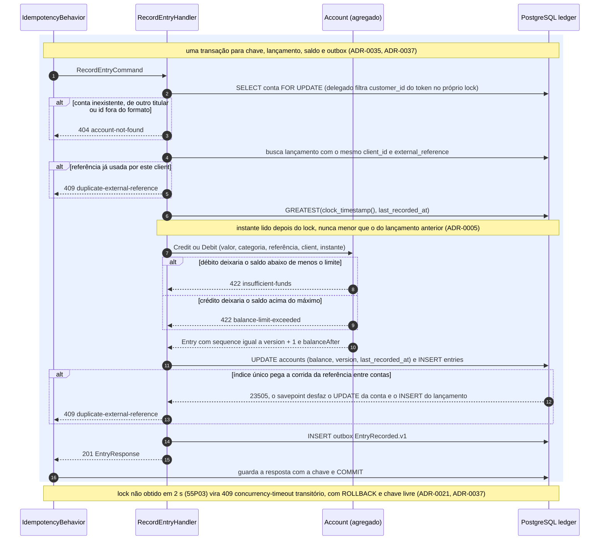
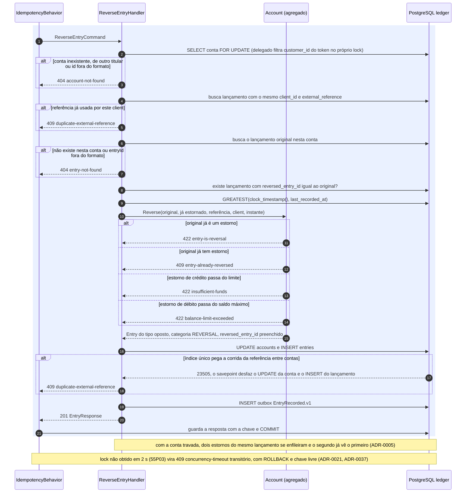
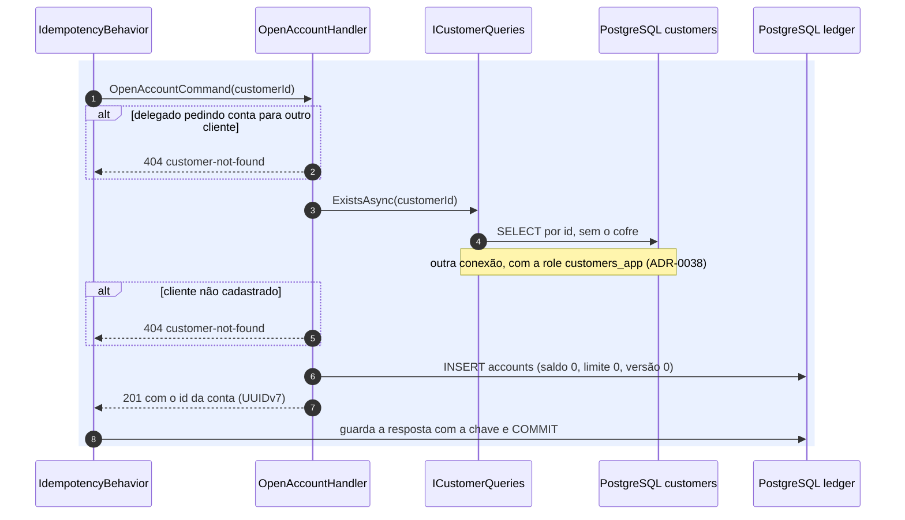
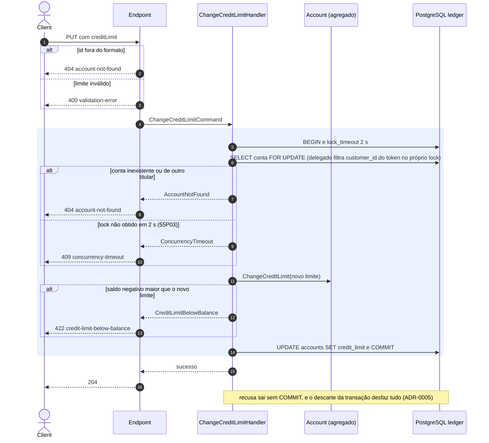
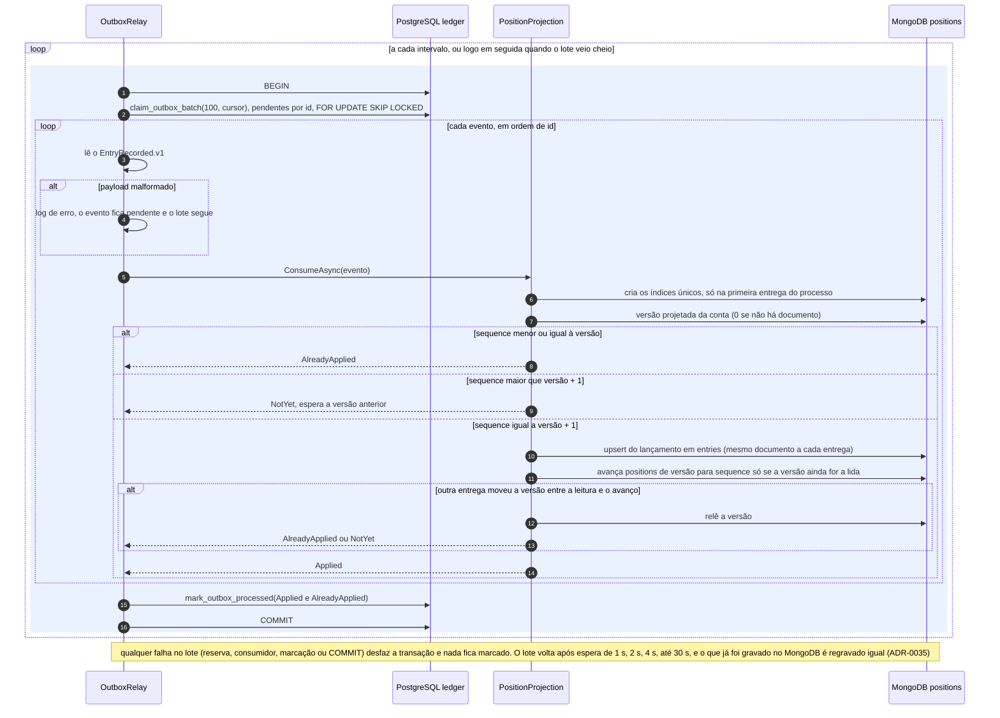
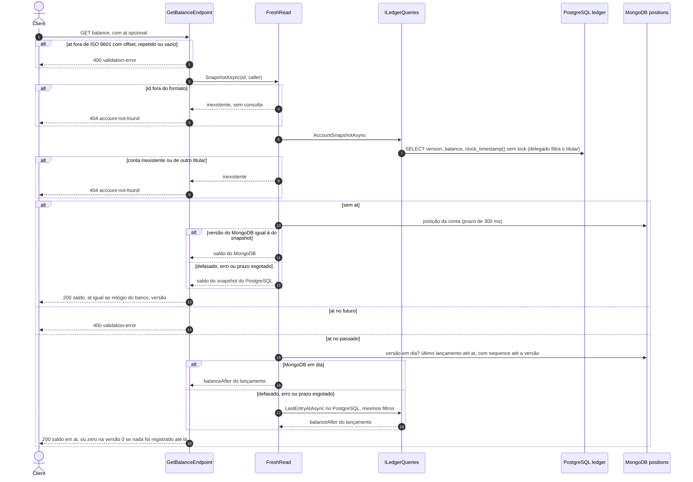
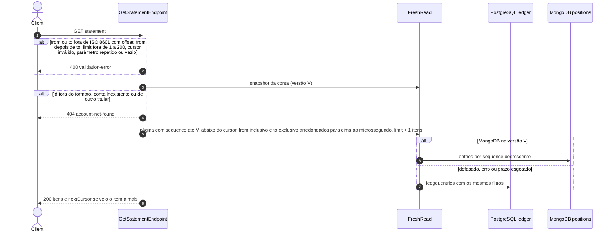
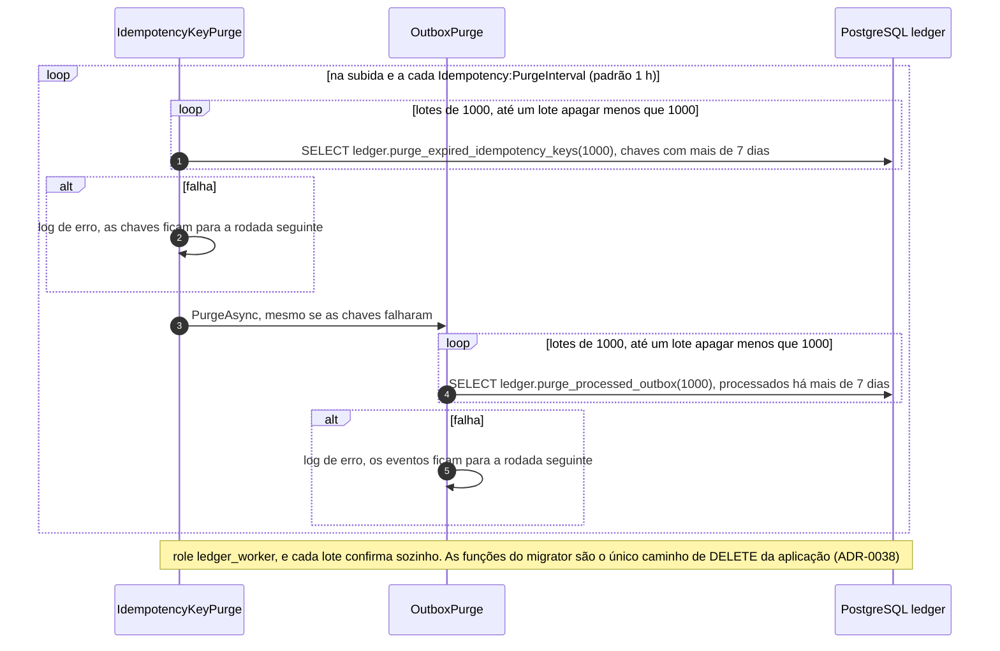

# Fluxos do Ledger e de Positions

Os `POST` passam antes pelo [pipeline comum de escrita](README.md#pipeline-comum-de-escrita-post):
autenticação, escopo, `Idempotency-Key`, validação do corpo e reserva da chave. Os diagramas abaixo
começam no `IdempotencyBehavior`, com a transação já aberta e `lock_timeout` de 2 s.

## Crédito e débito

`POST /v1/accounts/{id}/credits` (escopo `ledger.credits.write`) e
`POST /v1/accounts/{id}/debits` (escopo `ledger.debits.write`). As rotas e os escopos são separados:
quem só credita não consegue debitar (ADR-0039).

Id de conta fora do formato vai ao handler como `Guid.Empty`, e o `404` é guardado com a chave como o
de uma conta inexistente. O `409 duplicate-external-reference` leva `entryId` e `accountId` do
lançamento existente quando o chamador pode ver a conta dele (ADR-0013).

| Etapa | Código | Decisão |
|-------|--------|---------|
| Endpoint, leitura do corpo e envio do comando | [RecordEntry.cs](../../src/Modules/Ledger/Ledger/Features/RecordEntry/RecordEntry.cs) | ADR-0030, ADR-0039 |
| Referência externa, outbox e recusa de duplicata | [EntryWrites.cs](../../src/Modules/Ledger/Ledger/Features/EntryWrites.cs) | ADR-0037 |
| Lock pessimista, filtro do titular e instante de registro | [AccountWrites.cs](../../src/Modules/Ledger/Ledger/Infrastructure/Persistence/AccountWrites.cs) | ADR-0005, ADR-0013, ADR-0021 |
| Regras de saldo, limite e versão | [Account.cs](../../src/Modules/Ledger/Ledger/Domain/Account.cs) | ADR-0001, ADR-0003 |
| Payload do evento | [OutboxEvent.cs](../../src/Modules/Ledger/Ledger/Infrastructure/Outbox/OutboxEvent.cs) | ADR-0006, ADR-0035 |
| Catálogo de recusas | [LedgerProblems.cs](../../src/Modules/Ledger/Ledger/Features/LedgerProblems.cs) | ADR-0039 |

## Estorno

`POST /v1/accounts/{id}/entries/{entryId}/reversal`, escopo `ledger.entries.reverse`. Mesmo caminho
do crédito e do débito: lock da conta, referência externa, outbox. Muda só a decisão no meio.

| Etapa | Código | Decisão |
|-------|--------|---------|
| Endpoint, ids fora do formato e busca do original | [ReverseEntry.cs](../../src/Modules/Ledger/Ledger/Features/ReverseEntry/ReverseEntry.cs) | ADR-0013, ADR-0039 |
| Lock, referência externa e outbox, como no crédito | [EntryWrites.cs](../../src/Modules/Ledger/Ledger/Features/EntryWrites.cs), [AccountWrites.cs](../../src/Modules/Ledger/Ledger/Infrastructure/Persistence/AccountWrites.cs) | ADR-0005, ADR-0035, ADR-0037 |
| Regras do estorno | `Account.Reverse` em [Account.cs](../../src/Modules/Ledger/Ledger/Domain/Account.cs) | ADR-0001, ADR-0003 |

## Abertura de conta

`POST /v1/accounts`, escopo `ledger.accounts.manage`. Não gera lançamento nem evento: a conta nova
está na versão 0, que é também a versão de uma conta sem documento no MongoDB.

| Etapa | Código | Decisão |
|-------|--------|---------|
| Endpoint, recusa do delegado e INSERT | [OpenAccount.cs](../../src/Modules/Ledger/Ledger/Features/OpenAccount/OpenAccount.cs) | ADR-0013, ADR-0039 |
| Cliente existe, só pelo PostgreSQL | [CustomerQueries.cs](../../src/Modules/Customers/Customers/Infrastructure/Persistence/CustomerQueries.cs) | ADR-0016, ADR-0031 |

O `404` vale para os dois casos e não revela se o cliente existe (ADR-0013).

## Troca do limite de crédito

`PUT /v1/accounts/{id}/credit-limit`, escopo `ledger.accounts.manage`. Único comando de escrita sem
`Idempotency-Key`: não passa pelo behavior, e a transação é do próprio handler.

| Etapa | Código | Decisão |
|-------|--------|---------|
| Endpoint, transação do handler e recusas | [ChangeCreditLimit.cs](../../src/Modules/Ledger/Ledger/Features/ChangeCreditLimit/ChangeCreditLimit.cs) | ADR-0021, ADR-0039 |
| Lock e filtro do titular | [AccountWrites.cs](../../src/Modules/Ledger/Ledger/Infrastructure/Persistence/AccountWrites.cs) | ADR-0005, ADR-0013 |
| Regra do limite | [Account.cs](../../src/Modules/Ledger/Ledger/Domain/Account.cs) | ADR-0001 |

Não muda a versão nem gera lançamento, então não há evento para projetar.

## Do outbox ao MongoDB (Worker)

Assíncrono. O `OutboxRelay` consulta o outbox a cada `Outbox:PollInterval` (padrão 1 s) e entrega
cada evento à projeção de Positions pelo contrato `IEntryRecordedConsumer`.

| Etapa | Código | Decisão |
|-------|--------|---------|
| Polling, lote, cursor e espera crescente | [OutboxRelay.cs](../../src/Modules/Ledger/Ledger/Infrastructure/Outbox/OutboxRelay.cs) | ADR-0035 |
| Funções `claim_outbox_batch` e `mark_outbox_processed` | [Migração do outbox](../../src/Modules/Ledger/Ledger/Infrastructure/Persistence/Migrations/20261031233000_Outbox.cs) | ADR-0035, ADR-0038 |
| Regra da próxima versão estrita | [PositionProjection.cs](../../src/Modules/Positions/Positions/Projections/PositionProjection.cs) | ADR-0035 |
| Documentos e índices únicos no MongoDB | [ReadModelStore.cs](../../src/Modules/Positions/Positions/Infrastructure/ReadModelStore.cs) | ADR-0006 |

O lançamento é gravado antes da versão. Uma queda entre os dois passos deixa a versão parada, e a
próxima entrega regrava o mesmo documento e avança. Quem lê vê só lançamentos até a versão.

## Saldo atual e saldo em um momento

`GET /v1/accounts/{id}/balance[?at=...]`, escopo `positions.read`. O PostgreSQL diz qual é a versão
da conta, e o MongoDB responde só se estiver nela. Em qualquer outro caso, a resposta sai do Ledger
com os mesmos valores.

| Etapa | Código | Decisão |
|-------|--------|---------|
| Endpoint e regra do `at` | [GetBalance.cs](../../src/Modules/Positions/Positions/Features/GetBalance/GetBalance.cs) | ADR-0002, ADR-0003 |
| Escolha entre MongoDB e PostgreSQL, com prazo | [FreshRead.cs](../../src/Modules/Positions/Positions/Features/FreshRead.cs) | ADR-0007, ADR-0035 |
| Consultas do Ledger sem lock | [LedgerQueries.cs](../../src/Modules/Ledger/Ledger/Infrastructure/Persistence/LedgerQueries.cs) | ADR-0007, ADR-0031 |
| Leitura de query string | [PositionsQuery.cs](../../src/Modules/Positions/Positions/Features/PositionsQuery.cs) | ADR-0039 |

O instante `at` é truncado ao microssegundo antes da comparação. O MongoDB guarda microssegundos
desde a época Unix, porque um `date` BSON só guarda milissegundos e o saldo divergiria do PostgreSQL.

## Extrato

`GET /v1/accounts/{id}/statement?from&to&limit&cursor`, escopo `positions.read`. Mesmo snapshot e
mesma escolha de fonte do saldo, aplicados a uma página.

| Etapa | Código | Decisão |
|-------|--------|---------|
| Endpoint, página e cursor seguinte | [GetStatement.cs](../../src/Modules/Positions/Positions/Features/GetStatement/GetStatement.cs) | ADR-0007, ADR-0039 |
| Cursor opaco | [StatementCursor.cs](../../src/Modules/Positions/Positions/Features/StatementCursor.cs) | ADR-0039 |
| Leitura de query string | [PositionsQuery.cs](../../src/Modules/Positions/Positions/Features/PositionsQuery.cs) | ADR-0039 |

O teto em `V` faz as páginas seguintes ignorarem lançamentos novos: o extrato é um retrato da versão
lida.

## Limpeza (Worker)

| Etapa | Código | Decisão |
|-------|--------|---------|
| Agenda e chaves vencidas | [IdempotencyKeyPurge.cs](../../src/Modules/Ledger/Ledger/Infrastructure/Idempotency/IdempotencyKeyPurge.cs) | ADR-0037, ADR-0038 |
| Eventos processados | [OutboxPurge.cs](../../src/Modules/Ledger/Ledger/Infrastructure/Outbox/OutboxPurge.cs) | ADR-0035, ADR-0038 |
| Lotes que confirmam sozinhos | [BatchedPurge.cs](../../src/BuildingBlocks/Persistence/BatchedPurge.cs) | ADR-0038 |
