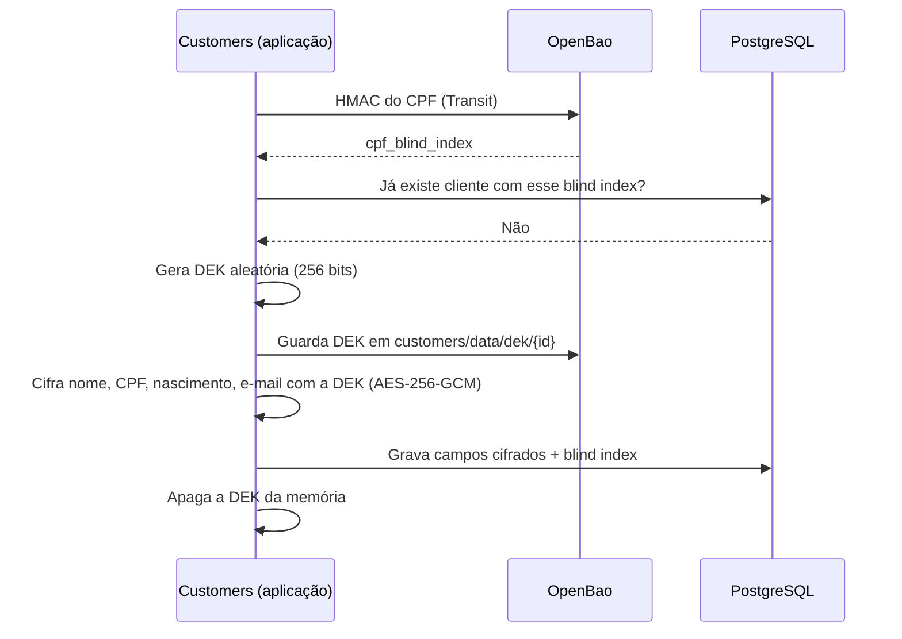

# Criptografia explicada

Guia didático da proteção de dados pessoais deste projeto. Explica cada conceito do zero, com
analogias, e mostra passo a passo o que acontece em cada operação. As decisões formais estão no
[ADR-0016](../adr/0016-criptografia-de-dados-pessoais.md) e no
[ADR-0017](../adr/0017-lgpd-minimizacao-direitos-e-bloqueio.md).

> **Situação:** o cadastro e a leitura de cliente estão construídos (funcionalidade **F5** do
> [roteiro](../roadmap.md)): o OpenBao no `docker-compose.yml`, a cifragem com DEK por cliente, o
> blind index do CPF e a máscara. A redação automática de dados pessoais nos logs está prevista no
> **F6**. O pedido de eliminação, o bloqueio e o crypto-shredding são um complemento do F6, feito
> se houver tempo; a busca por CPF ainda não tem rota. Este guia explica o desenho completo; os
> trechos ainda não construídos estão marcados como previstos.

## 1. O problema

O módulo Customers guarda nome, CPF, data de nascimento e e-mail. Se alguém conseguir uma cópia do
banco de dados (um backup vazado, um dump, um ataque de SQL injection, um funcionário com acesso
indevido), essa pessoa não pode conseguir ler esses dados.

Além disso, a LGPD dá ao cliente o direito de pedir a eliminação dos seus dados. Só que backups de
banco são imutáveis: não dá para "entrar" em um backup de seis meses atrás e apagar uma linha.

A solução precisa resolver as duas coisas.

## 2. Conceitos básicos

### Criptografia simétrica

Uma **chave** é um número secreto e aleatório (aqui, 256 bits, ou seja, um número com cerca de 77
dígitos). A mesma chave serve para **cifrar** (transformar o dado legível em algo ilegível) e
**decifrar** (o caminho inverso).

> **Analogia:** um cadeado cuja mesma chave tranca e destranca.

```
"123.456.789-09"  + chave  →  cifrar    →  "a8f3...9c1e" (ilegível)
"a8f3...9c1e"     + chave  →  decifrar  →  "123.456.789-09"
```

Sem a chave, o texto cifrado é inútil. Testar todas as chaves possíveis de 256 bits levaria mais
tempo do que a idade do universo, mesmo com todos os computadores do mundo.

### AES-256-GCM

**AES** é o algoritmo de criptografia simétrica padrão no mundo (usado por bancos, governos, HTTPS).
**256** é o tamanho da chave em bits. **GCM** é o "modo de operação", e ele traz um bônus
importante: além de esconder o dado, ele **detecta adulteração**.

Ao cifrar, o GCM produz também uma **tag de autenticação** (16 bytes), que funciona como um lacre.
Se qualquer byte do texto cifrado for alterado, a decifragem falha em vez de devolver um dado
errado.

> **Analogia:** um envelope com lacre de cera. Se alguém abrir e fechar de novo, o lacre denuncia.

Por que isso importa: sem detecção de adulteração, um atacante com acesso ao banco poderia alterar
bytes do CPF cifrado e o sistema decifraria um valor corrompido sem perceber.

### Nonce

Cada vez que algo é cifrado, usamos também um **nonce** ("number used once"): 12 bytes aleatórios,
diferentes a cada operação. Ele não é secreto e fica guardado junto com o texto cifrado.

Para que serve: se o mesmo CPF fosse cifrado duas vezes com a mesma chave e sem nonce, o resultado
seria idêntico, e um atacante saberia que os dois registros têm o mesmo CPF. Com nonce, o mesmo
dado cifrado duas vezes gera resultados completamente diferentes.

**Regra de ouro do GCM:** nunca repetir um nonce com a mesma chave. Uma repetição permite ao
atacante descobrir informações sobre os dois dados e forjar lacres. Por isso o nonce é gerado
aleatoriamente a cada operação, e cada cliente tem sua própria chave, o que torna a chance de
repetição desprezível.

### AAD (dados autenticados associados)

O GCM permite "amarrar" o texto cifrado a um contexto, sem cifrar esse contexto. O desenho usa
como contexto o **id do cliente + nome do campo**.

Problema que isso evita: um atacante com acesso de escrita ao banco copia o CPF cifrado do cliente
A para o registro do cliente B. Sem AAD, se os dois usassem a mesma chave, a decifragem
funcionaria. Com AAD, a decifragem no registro de B falha, porque o lacre foi calculado para
"cliente A, campo CPF".

### Formato armazenado

Cada campo cifrado será guardado no banco como uma sequência de bytes:

```
| versão (1 byte) | nonce (12 bytes) | texto cifrado | tag (16 bytes) |
```

A **versão do formato** vai permitir mudar o algoritmo no futuro sem confusão: o sistema sabe como
decifrar cada registro olhando o primeiro byte.

## 3. Hash, HMAC e a busca por CPF

### O problema da busca

Com o CPF cifrado (e cada cifragem gerando um resultado diferente por causa do nonce), como
encontrar "o cliente com CPF 123.456.789-09"? E como impedir dois cadastros com o mesmo CPF? Não dá
para fazer `WHERE cpf = ...` em dados cifrados.

### Hash

Um **hash** (ex.: SHA-256) transforma qualquer dado em uma "impressão digital" de tamanho fixo. O
mesmo dado sempre gera o mesmo hash, e não dá para fazer o caminho inverso matematicamente.

> **Analogia:** impressão digital. A partir da pessoa você obtém a digital, mas a partir da digital
> você não reconstrói a pessoa.

Parece resolver: guardamos o hash do CPF e buscamos por ele. **Mas há uma armadilha.**

### Por que hash simples é inseguro para CPF

O CPF tem 11 dígitos, sendo 2 verificadores calculados a partir dos outros 9. Existem, portanto,
cerca de **1 bilhão** de CPFs válidos. Uma placa de vídeo comum calcula bilhões de hashes SHA-256
por segundo. Então um atacante com o banco em mãos faz assim:

1. Calcula o hash de todos os CPFs possíveis (minutos de processamento).
2. Compara com os hashes do banco.
3. Descobre todos os CPFs.

O hash não é reversível matematicamente, mas é reversível **por força bruta** quando o universo de
valores possíveis é pequeno.

### HMAC: hash com chave secreta

**HMAC** é um hash que exige uma chave secreta para ser calculado. Sem a chave, o atacante não
consegue calcular o HMAC de nenhum CPF, então a força bruta deixa de funcionar.

> **Analogia:** uma impressão digital que só pode ser tirada com um equipamento que fica trancado
> no cofre.

### Blind index

O **blind index** ("índice cego") é a coluna `cpf_blind_index`, que guarda o HMAC do CPF (os 32
bytes; a versão da chave que o calculou fica em `cpf_blind_index_version`). Ela permite:

- **Buscar:** calcula o HMAC do CPF procurado e faz `WHERE cpf_blind_index = ...` (prevista: a
  busca por CPF ainda não tem rota).
- **Impedir duplicidade:** a coluna tem índice único; o segundo cadastro do mesmo CPF responde
  `409` `cpf-already-registered`, sem revelar de quem é o CPF.

E o banco nunca vê o CPF. Neste projeto, o HMAC é calculado **dentro do OpenBao** (engine
Transit, chave `customers-blind-index`), então a chave do HMAC nunca sai do cofre, nem para a
memória da aplicação.

O mesmo cuidado vale para a chave de idempotência do cadastro: o hash que identifica "a mesma
requisição" é um HMAC no Transit com outra chave, `customers-request-hash` (ADR-0037). Um SHA-256
sem chave do nome, do CPF, do nascimento e do e-mail deixaria testar CPFs na linha da chave.

### Rotação da chave do blind index (procedimento)

A rotação não é automática, e a política da Api não a permite. A unicidade compara só os 32 bytes
do HMAC: o mesmo CPF gera bytes diferentes em cada versão da chave. Logo, depois de rotacionar,
um CPF gravado na versão 1 e enviado de novo passaria pela consulta e pelo índice único na versão
2, até que todas as linhas sejam recalculadas (ADR-0016). Por isso, a rotação segue estes passos,
sem cadastros no meio:

1. Pare os cadastros: a Api fora do ar, ou a rota `POST /v1/customers` bloqueada na borda.
2. Com um token de administração do cofre (nunca o AppRole da Api), rotacione a chave:
   `bao write -f transit/keys/customers-blind-index/rotate`.
3. Recalcule cada linha: decifre o CPF com a DEK do cliente, calcule o HMAC na versão nova e grave
   `cpf_blind_index` e `cpf_blind_index_version`. A `customers_app` não tem `UPDATE` nessas
   colunas, então isso roda como manutenção, com uma role própria; ainda não há script pronto.
4. Confira que nenhuma linha ficou na versão antiga (`cpf_blind_index_version`) e retome os
   cadastros.

A chave `customers-request-hash` tem outro cuidado: o hash guardado com cada chave de idempotência
não registra a versão. Rotacionada, a repetição de um cadastro feito antes responde `422`
`idempotency-key-reused` em vez da resposta original, até as chaves antigas expirarem (7 dias).

## 4. Envelope encryption: chaves que protegem chaves

### Por que uma chave por cliente

Se todos os clientes usassem a mesma chave, eliminar os dados de um cliente específico exigiria
alterar o banco e todos os backups, o que é impossível. Com **uma chave por cliente**, eliminar a
chave daquele cliente torna os dados dele ilegíveis em todo lugar.

Essa chave por cliente se chama **DEK** (*Data Encryption Key*, chave de dados).

### Onde guardar as DEKs

Esta é a decisão mais sutil do desenho.

**Opção descartada: guardar a DEK no próprio banco.** Mesmo que a DEK esteja cifrada por uma chave
mestra, o backup do banco conteria os dados cifrados **e** a DEK do cliente juntos. Como a chave
mestra continua existindo, quem restaurasse um backup antigo conseguiria decifrar a DEK e, com
ela, os dados de um cliente que já pediu eliminação.

> **Analogia:** guardar o cofre e a chave do cofre na mesma gaveta. Jogar fora a cópia da chave que
> está em cima da mesa não adianta se a gaveta (o backup) ainda tem outra cópia.

**Opção adotada: guardar a DEK no cofre de chaves (OpenBao), fora do banco.** O backup do banco
passa a conter apenas dados cifrados, sem nenhuma chave. Destruir a DEK no cofre torna os dados
ilegíveis no banco e em todos os backups do banco.

> **Analogia:** os documentos ficam no arquivo (banco), e as chaves de cada gaveta ficam no cofre
> do gerente (OpenBao). Destruir a chave de uma gaveta no cofre torna aquela gaveta impossível de
> abrir, inclusive em cópias antigas do arquivo.

### Crypto-shredding

Esse ato de "eliminar dados destruindo a chave" se chama **crypto-shredding** (trituração
criptográfica). É a forma de cumprir o direito de eliminação mesmo com backups imutáveis.

**Ressalva honesta:** o próprio OpenBao também tem backups, e eles contêm a DEK até expirarem. Por
isso, os backups do cofre devem ter retenção curta e separada (ex.: 30 dias). A eliminação é definitiva
quando esse prazo passa.

## 5. O cofre de chaves: OpenBao

O **OpenBao** é um software especializado em guardar segredos e fazer operações criptográficas com
segurança. É um projeto open source (licença MPL 2.0), mantido pela Linux Foundation, compatível
com o HashiCorp Vault.

O OpenBao entrou no projeto no F5. Recursos usados:

| Recurso | Para que é usado |
|---------|------------------|
| **KV v2** (armazenamento de segredos) | Guardar a DEK de cada cliente em `customers/data/dek/{customerId}`, gravada só se ainda não existe (`cas=0`) |
| **Transit** (criptografia como serviço) | Calcular o HMAC do CPF e o hash da chave de idempotência com chaves que nunca saem do cofre |
| **AppRole** (autenticação de aplicações) | A Api se identifica como `customers-api` e recebe permissões mínimas |
| **Políticas** | A política `customers-app` permite criar e ler DEKs e calcular os dois HMACs, e nada mais: nem apagar, nem sobrescrever, nem exportar |

### Selado e deslacrado (seal/unseal)

O próprio OpenBao guarda tudo cifrado em disco. Quando ele inicia, está **selado**: não consegue
ler os próprios dados até receber a chave de desbloqueio. Esse processo se chama *unseal*.

No ambiente local, o cofre usa **auto-unseal estático**: a chave de desbloqueio vem de uma
variável de ambiente, então o cofre abre sozinho ao subir. Isso é aceitável apenas em
desenvolvimento. Na primeira subida, o container `openbao-bootstrap` inicializa o cofre, liga o
KV v2 e o Transit, cria as duas chaves de HMAC, a política e o AppRole; nas subidas seguintes ele
confere o que já existe e não troca nenhuma chave.

**Por que não usar o modo `-dev` do OpenBao**, que é mais simples: ele guarda tudo apenas em
memória. Se o container reiniciar, todas as DEKs desaparecem, e todos os dados pessoais do banco
ficam ilegíveis para sempre. Seria um crypto-shredding acidental de todos os clientes.

## 6. Passo a passo de cada operação

Os fluxos abaixo descrevem como o módulo Customers funciona. Cadastro e leitura estão construídos;
a busca por CPF e a eliminação estão previstas.

### Cadastro de cliente



### Leitura dos dados de um cliente

1. A aplicação busca o registro cifrado no banco.
2. Busca a DEK do cliente no OpenBao (ou no cache em memória, válido por 5 minutos).
3. Decifra cada campo. O GCM verifica o lacre e a AAD: se algo foi adulterado ou copiado de outro
   cliente ou de outro campo, falha, a resposta é `500` e o log registra só o id e o nome do campo.
4. A rota decide o formato. `GET /v1/customers/{id}`, com `customers.read`, devolve os dados
   mascarados (o CPF sai como `***.456.789-**`). `GET /v1/customers/{id}/personal-data`, com
   `customers.pii.read`, grava o acesso na trilha de auditoria (`customers.audit_events`), só com
   identificadores, e só então devolve os dados completos (ADR-0041, ADR-0042).

### Trilha de auditoria: quem acessou o quê

Cada leitura dos dados completos e cada tentativa de escrita deixam uma linha em `audit_events` do
módulo (ADR-0041). A linha diz quem pediu, em nome de quem, o quê e com que resultado, sem nenhum dado
pessoal: só ids, o nome da operação, o status HTTP e o `traceId`, o mesmo das respostas de erro e dos
logs. A Api só insere linhas, e um trigger recusa `UPDATE`, `DELETE` e `TRUNCATE` de qualquer role.
A dona do schema (`migrator`) e o superusuário ainda podem desligar o trigger com DDL; o PostgreSQL
loga todo DDL com quem o executou, e esse rastro é o que denuncia o abuso (ADR-0044).

Nenhuma rota lê a trilha. A consulta é por SQL, com a role `migrator`, dona dos schemas. Por exemplo,
quem leu os dados completos de um cliente:

```sql
SELECT occurred_at, client_id, caller_customer_id, result, trace_id
FROM customers.audit_events
WHERE operation = 'read-personal-data' AND resource_id = '<id do cliente>'
ORDER BY occurred_at;
```

E tudo o que um client fez no Ledger num dia:

```sql
SELECT occurred_at, operation, resource_type, resource_id, result
FROM ledger.audit_events
WHERE client_id = 'payments-hub' AND occurred_at >= '2026-11-01' AND occurred_at < '2026-11-02'
ORDER BY occurred_at;
```

`resource_id` é null quando o id da rota não era um UUID (pode ser qualquer texto, até um CPF, e por
isso não entra) ou quando o recurso não chegou a existir, como num cadastro recusado.

### Dado pessoal nos logs

Os logs não são cifrados nem eliminados com o cliente. Por isso, um parâmetro de log que carrega
nome, CPF, nascimento ou e-mail leva a marca `[PersonalData]`, e a configuração de logging da Api e
do Worker escreve o valor marcado como texto vazio. Um teste de arquitetura falha se um método de log
recebe um desses valores sem a marca.

### Busca por CPF (prevista)

1. A aplicação pede ao OpenBao o HMAC do CPF informado.
2. Busca no banco por `cpf_blind_index`.
3. Se encontrar, segue o fluxo de leitura.

### Eliminação (previsto, complemento do F6)

1. O pedido é registrado e os dados ficam **bloqueados** (ninguém lê) durante o prazo de guarda
   legal (ADR-0017).
2. Ao fim do prazo, o Worker destrói a DEK no OpenBao.
3. Os campos cifrados no banco e nos backups do banco tornam-se permanentemente ilegíveis.
4. O registro do cliente permanece apenas como marcador, para que o histórico financeiro continue
   referenciando um id válido.

## 7. O que um atacante vê em cada cenário

A tabela descreve o desenho completo. As linhas de logs e de backup após eliminação dependem do
F6; as demais já valem.

| Cenário | O que o atacante obtém |
|---------|------------------------|
| Rouba um backup do banco | Bytes cifrados e blind indexes. Sem DEKs e sem chave de HMAC: nada legível, e força bruta no CPF impossível |
| SQL injection no módulo Ledger | Nada de Customers: a role do Ledger não tem permissão no schema `customers` (ADR-0044) |
| SQL injection no módulo Customers | Dados cifrados, mesma situação do backup |
| Altera bytes cifrados no banco | A decifragem falha (lacre do GCM); o sistema detecta e não exibe dado corrompido |
| Copia o CPF cifrado de um cliente para outro | A decifragem falha (AAD amarra o dado ao cliente e ao campo) |
| Lê os logs da aplicação | Nenhum dado pessoal: redação automática (ADR-0017; prevista, F6) |
| Restaura um backup antigo após uma eliminação | Os dados do cliente eliminado continuam ilegíveis: a DEK não existe mais (previsto, complemento do F6) |
| Compromete o OpenBao | Cenário mais grave: por isso o cofre tem acesso restrito, autenticação por AppRole e, em produção, alta disponibilidade e monitoramento próprio |

## 8. Glossário rápido

| Termo | Significado |
|-------|-------------|
| Chave | Número secreto aleatório usado para cifrar e decifrar |
| Cifrar / decifrar | Tornar ilegível / legível de novo, usando a chave |
| AES-256-GCM | Algoritmo padrão de criptografia simétrica, com detecção de adulteração |
| Nonce | Valor aleatório, não secreto, único por cifragem |
| Tag | "Lacre" que denuncia adulteração |
| AAD | Contexto que amarra o dado cifrado a um cliente e a um campo |
| Hash | Impressão digital de um dado; não reversível matematicamente |
| HMAC | Hash que exige chave secreta; impede força bruta |
| Blind index | Coluna com HMAC do CPF, permite busca sem revelar o CPF |
| DEK | Chave de dados, uma por cliente |
| Envelope encryption | Padrão de chaves protegendo chaves |
| Crypto-shredding | Eliminar dados destruindo a chave que os decifra |
| OpenBao | Cofre de segredos e operações criptográficas |
| Seal / unseal | Estado trancado / destrancado do cofre |
| AppRole | Forma de uma aplicação se autenticar no cofre |
