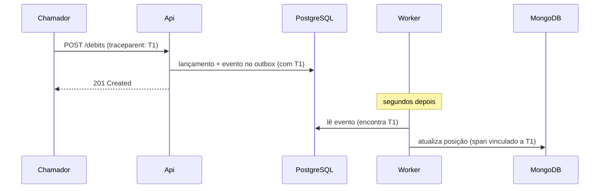

# Observabilidade explicada

Guia didático de como o sistema é observado em funcionamento. A decisão formal está no
[ADR-0022](../adr/0022-observabilidade-com-opentelemetry.md).

## 1. O problema

Um sistema em produção falha de formas sutis antes de falhar de vez. Neste projeto, por exemplo:

- O MongoDB pode estar 40 segundos atrasado, e as consultas estão sendo respondidas pelo PostgreSQL
  (fallback). Nenhum cliente percebe nada, mas o PostgreSQL está trabalhando dobrado.
- Uma conta muito movimentada pode estar fazendo débitos esperarem 1,5 segundo pelo lock. Ainda
  abaixo do limite de 2 segundos, mas perto.
- O rate limiting pode estar recusando 30% das requisições de um sistema chamador com defeito.

Tudo isso "funciona". E tudo isso é um incidente prestes a acontecer. **Observabilidade é a
capacidade de enxergar esses estados por fora, sem precisar abrir o código ou o banco.**

> **Analogia:** o painel de um carro. Você não abre o motor para saber se a temperatura está
> subindo; o ponteiro avisa antes de o motor ferver.

## 2. Os três sinais

| Sinal | Pergunta que responde | Analogia |
|-------|-----------------------|----------|
| **Métricas** | "Quanto? Com que frequência? Está piorando?" | Ponteiros do painel do carro |
| **Logs** | "O que exatamente aconteceu neste momento?" | Diário de bordo |
| **Traces** | "Por onde esta operação passou e onde demorou?" | Rastreamento de encomenda dos Correios |

### Métricas

Números agregados ao longo do tempo. Baratas de armazenar, ótimas para gráficos e alertas.

Tipos usados:

- **Contador:** só cresce. Ex.: total de débitos recusados. O gráfico mostra a taxa por minuto.
- **Gauge:** sobe e desce. Ex.: quantos eventos estão pendentes no outbox agora.
- **Histograma:** distribuição de valores. Ex.: tempo de espera pelo lock. Permite ver não só a
  média, mas o pior caso, como "99% das esperas ficam abaixo de 200 ms".

Por que o pior caso importa: a média esconde problemas. Se 99 débitos levam 10 ms e 1 leva 5
segundos, a média é 60 ms (parece ótimo), mas um cliente esperou 5 segundos.

### Logs

Registros de eventos individuais. Neste projeto são **estruturados**: em vez de uma frase solta, cada
log é um conjunto de campos pesquisáveis.

```
Frase solta:     "Débito recusado na conta 8f2c por saldo insuficiente"
Estruturado:     { evento: "DebitRejected", account_id: "8f2c", motivo: "insufficient-funds",
                   trace_id: "4bf9..." }
```

O estruturado permite perguntar "quantos débitos foram recusados por saldo insuficiente na última
hora?" sem procurar texto.

**Dados pessoais nunca aparecem em logs**: a redação automática do ADR-0017 substitui campos
classificados antes de o log ser escrito.

### Traces

Um **trace** é a história completa de uma operação. Ele é composto de **spans**: cada span é um
trecho do trabalho, com início, fim e duração.

```
POST /v1/accounts/8f2c/debits                     [========================] 48 ms
  ├─ autenticação e autorização                   [==]                        3 ms
  ├─ verificação de idempotência                  [==]                        2 ms
  ├─ SELECT ... FOR UPDATE (espera pelo lock)       [==========]             19 ms
  ├─ INSERT lançamento + outbox                                 [====]        8 ms
  └─ COMMIT                                                         [===]     6 ms
```

Olhando esse trace, fica óbvio onde o tempo foi gasto: a espera pelo lock. Sem trace, só se saberia
"o débito demorou 48 ms".

## 3. OpenTelemetry

**OpenTelemetry** (OTel) é um padrão aberto, mantido pela CNCF, para gerar e transmitir métricas,
logs e traces. O código do sistema fala "OpenTelemetry", e quem recebe os dados pode ser qualquer
ferramenta compatível (Grafana, Datadog, New Relic, Azure Monitor...).

> **Analogia:** a tomada padrão. O aparelho (sistema) não precisa saber de qual usina vem a energia
> (ferramenta de observabilidade).

O protocolo de envio se chama **OTLP**. Trocar de ferramenta em produção é mudar o endereço de
destino, sem alterar o código.

A maior parte da instrumentação é **automática**: as bibliotecas de ASP.NET Core, PostgreSQL e
MongoDB já geram spans e métricas. O código só adiciona o que é específico do negócio (débitos
recusados, atraso do outbox, fallbacks).

## 4. Seguindo uma operação através do outbox

Este é o ponto mais interessante do desenho. Um débito acontece em **dois processos e em dois
momentos**:

1. A Api registra o débito no PostgreSQL e grava o evento no outbox.
2. Segundos depois, o Worker lê o evento e atualiza o MongoDB.

Normalmente, seriam dois traces sem relação. Para ligá-los, a Api grava no próprio evento do outbox
o **`traceparent`**, um identificador padronizado (W3C Trace Context) do trace em andamento. Quando o
Worker processa o evento, ele cria seu span **vinculado** a esse identificador.



Resultado: abrindo o trace T1 no Grafana, aparecem a requisição, o commit **e** a projeção. Se um
cliente reclamar que "o débito demorou para aparecer no extrato", o trace mostra exatamente quanto
tempo o evento ficou no outbox.

## 5. As métricas deste sistema e o que cada uma revela

| Métrica | Situação normal | Sinal de problema |
|---------|-----------------|-------------------|
| `outbox.lag.seconds` | Abaixo de 1 s | Subindo: Worker parado, lento ou MongoDB com problema |
| `outbox.pending` | Perto de zero | Crescendo sem parar: projeção não acompanha o volume |
| `positions.fallback` | Raro | Frequente: MongoDB atrasado ou fora; PostgreSQL sob carga extra |
| `ledger.lock.wait` | Poucos milissegundos | Alto: conta quente; candidata a sub-ledger (ADR-0003) |
| `ledger.debits.rejected` | Estável | Pico súbito: possível defeito em um canal ou fraude |
| `idempotency.replays` | Baixo | Alto: chamadores repetindo muito, rede instável |
| `http.server.rejected` | Perto de zero | Alto: sobrecarga ou client com defeito |
| `resilience.circuit.state` | Fechado | Aberto: dependência fora do ar |

### Cuidado com cardinalidade

Cada combinação de rótulos de uma métrica vira uma série separada no banco de métricas. Rotular por
`client_id` (poucas dezenas) é seguro. Rotular por `account_id` (milhões) criaria milhões de séries e
derrubaria o Prometheus. Por isso, **identificadores de conta e de cliente são proibidos como rótulos
de métricas**; eles aparecem apenas em traces e logs.

## 6. Alertas

Uma métrica que ninguém olha não protege nada. Os alertas avisam quando algo sai do normal:

| Alerta | Dispara quando | Por que importa |
|--------|----------------|-----------------|
| Modelo de leitura atrasado | Atraso do outbox > 30 s por 2 min | O fallback está segurando as consultas, mas o PostgreSQL está sobrecarregado |
| Fallback elevado | > 5% das consultas por 5 min | Mesmo motivo, visto pelo lado da consulta |
| Disjuntor aberto | > 1 min | Uma dependência está fora |
| Descarte de carga | `503` > 1% por 5 min | O sistema está recusando trabalho; precisa de capacidade |

A condição "por N minutos" evita alarmes falsos por oscilações momentâneas.

Dashboard e alertas são **provisionados como código**: ficam em arquivos no repositório e aparecem
prontos no Grafana ao subir o ambiente. Ninguém precisa configurar nada à mão, e qualquer mudança
passa por revisão de código.

## 7. O ambiente local: Grafana LGTM

O container `grafana/otel-lgtm` reúne quatro ferramentas:

| Letra | Ferramenta | Guarda |
|-------|------------|--------|
| **L** | Loki | Logs |
| **G** | Grafana | Interface: dashboards, buscas, alertas |
| **T** | Tempo | Traces |
| **M** | Mimir / Prometheus | Métricas |

O sistema envia tudo via OTLP para esse container. No Grafana é possível, por exemplo, clicar em um
pico no gráfico de latência, abrir um trace daquele momento e, a partir do trace, ver os logs
daquela requisição exata, tudo ligado pelo `trace_id`.

## 8. Auditoria não é log

Parecem a mesma coisa, mas têm propósitos opostos:

| | Log de observabilidade | Registro de auditoria |
|---|---|---|
| Para quê | Diagnosticar o sistema | Provar quem fez o quê, para fins legais |
| Onde fica | Loki | Banco de dados, tabela própria |
| Pode ser descartado? | Sim: amostragem, retenção curta | Nunca, dentro do prazo legal |
| Pode ser alterado? | Irrelevante | Não: imutável |

Por isso a auditoria (ADR-0013) não depende da pilha de observabilidade: se o Loki cair, nenhum
registro de auditoria se perde.

## 9. Perguntas prováveis em entrevista

**Como você saberia que o MongoDB está atrasado antes de um cliente reclamar?** Pela métrica
`outbox.lag.seconds` e pelo alerta de atraso. E, na verdade, nenhum cliente reclamaria: o fallback
garante a consulta correta. O alerta existe para proteger o PostgreSQL da carga extra.

**Como você rastreia uma operação que passa por dois processos?** Gravando o `traceparent` no evento
do outbox e criando no Worker um span vinculado ao trace original.

**Por que OpenTelemetry e não a biblioteca de um fornecedor?** Para não ficar preso a ele. O código
fala o padrão, e trocar de ferramenta é configuração.

**Por que não usar `account_id` como rótulo de métrica?** Cardinalidade: milhões de séries
derrubariam o banco de métricas. Identificadores ficam em traces e logs.

**Auditoria não poderia ficar nos logs?** Não: logs podem ser amostrados e descartados, e a
auditoria tem obrigação legal de integridade e retenção.
