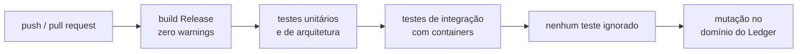

# Qualidade de build e CI explicados

Guia didático de como o projeto garante qualidade mecanicamente, sem depender de disciplina. A
decisão formal está no [ADR-0025](../adr/0025-qualidade-de-build-e-integracao-continua.md).

## 1. A ideia central

Regras que dependem de alguém lembrar de cumpri-las acabam sendo esquecidas. Por isso, cada regra
de qualidade deste projeto é **imposta por uma ferramenta**: se for violada, o build quebra ou o
pipeline reprova.

> **Analogia:** o cinto de segurança que impede o carro de dar partida, em vez de um aviso pedindo
> para colocar o cinto.

## 2. Warnings viram erros

Um *warning* é o compilador dizendo "isto compila, mas provavelmente está errado". Exemplos:
uma variável que pode ser nula sendo usada sem verificação; um resultado de operação assíncrona
ignorado.

Com `TreatWarningsAsErrors`, todo warning é tratado como erro: o código não compila até ser
corrigido. Isso cumpre o requisito "sem warnings" de forma garantida, não por inspeção.

**Nullable:** em C#, o erro mais comum em produção é acessar algo que está nulo. Com `Nullable`
ativado, o compilador acompanha quais valores podem ser nulos e acusa o uso sem verificação, ainda
na compilação.

**Analyzers:** regras adicionais que o .NET já traz (segurança, desempenho, uso correto de APIs).
Rodam durante a compilação e, como todo warning, quebram o build.

## 3. Dependências vulneráveis quebram o build

O projeto usa pacotes de terceiros (bibliotecas NuGet). Quando uma vulnerabilidade é descoberta em
um deles, ela é publicada em bases públicas.

O **NuGet Audit** compara os pacotes do projeto com essas bases a cada restauração. Achou pacote
vulnerável, gera warning, que vira erro. Resultado: é impossível compilar o projeto usando uma
versão com vulnerabilidade conhecida.

Efeito colateral aceito: se amanhã for divulgada uma vulnerabilidade em um pacote usado, o build
quebra até a atualização. Em um banco, esse é exatamente o comportamento desejado.

## 4. Uma versão de cada coisa

- **Central Package Management:** as versões de todos os pacotes ficam em um único arquivo
  (`Directory.Packages.props`). Sem isso, um projeto poderia usar a versão 8 de uma biblioteca e
  outro a versão 9, com comportamentos diferentes.
- **`global.json`:** fixa a versão do SDK do .NET. Quem clonar o repositório compila com a mesma
  versão de compilador, e o resultado é o mesmo em qualquer máquina.

## 5. O pipeline de integração contínua

A cada envio de código ao GitHub, o GitHub Actions executa automaticamente:

Qualquer etapa reprovada marca o envio como falho. Ninguém precisa lembrar de rodar os testes: eles
rodam sempre, e o resultado fica visível no repositório.

## 6. Segurança da cadeia de suprimentos

"Cadeia de suprimentos" é tudo de que o software depende para ser construído: pacotes, ferramentas,
o próprio pipeline. Um ataque a qualquer elo compromete o resultado.

| Mecanismo | O que faz |
|-----------|-----------|
| **CodeQL** | Lê o código procurando padrões de vulnerabilidade (injeção, uso inseguro de criptografia, vazamento de dados) |
| **Dependabot** | Abre automaticamente pull requests quando há versão nova de um pacote ou de uma action |
| **Secret scanning** | Detecta senhas, tokens e chaves em commits e bloqueia o envio |
| **Actions fixadas por hash** | Garante que o pipeline usa exatamente o código revisado de cada action |

**Por que fixar por hash e não por tag:** uma action é referenciada, por exemplo, como
`actions/checkout@v4`. A tag `v4` pode ser movida pelo dono da action para outro código. Se a conta
do dono for comprometida, o atacante move a tag para código malicioso e todo pipeline que usa `@v4`
passa a executá-lo. Um hash de commit identifica um conteúdo exato e não pode ser movido.

**Os segredos versionados de propósito:** a configuração local do Keycloak e a chave de unseal do
OpenBao estão no repositório para que o ambiente suba com um comando. São exclusivos do ambiente
local, identificados como tal, e não protegem nada real. Em produção, segredos ficam em cofre.
