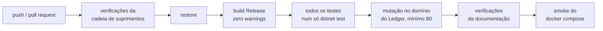

# Qualidade de build e CI explicados

Guia didático de como o projeto garante qualidade mecanicamente, sem depender de disciplina. A
decisão formal está no [ADR-0025](../adr/0025-qualidade-de-build-e-integracao-continua.md).

**Situação:** as regras de build, a auditoria de pacotes, as versões centralizadas, o pipeline e a
fixação de actions e imagens existem hoje. CodeQL e Dependabot são previstos (F10, ver o
[roteiro](../roadmap.md)).

## 1. A ideia central

Regras que dependem de alguém lembrar de cumpri-las acabam sendo esquecidas. Por isso, cada regra
de qualidade deste projeto é **imposta por uma ferramenta**: se for violada, o build quebra ou o
pipeline reprova.

> **Analogia:** o cinto de segurança que impede o carro de dar partida, em vez de um aviso pedindo
> para colocar o cinto.

## 2. Warnings viram erros

Um *warning* é o compilador dizendo "isto compila, mas provavelmente está errado". Exemplos:
uma variável que pode ser nula sendo usada sem verificação; um resultado de operação assíncrona
ignorado.

Com `TreatWarningsAsErrors`, todo warning é tratado como erro: o código não compila até ser
corrigido. Isso cumpre o requisito "sem warnings" de forma garantida, não por inspeção.

**Nullable:** em C#, o erro mais comum em produção é acessar algo que está nulo. Com `Nullable`
ativado, o compilador acompanha quais valores podem ser nulos e acusa o uso sem verificação, ainda
na compilação.

**Analyzers:** regras adicionais que o .NET já traz (segurança, desempenho, uso correto de APIs).
Rodam durante a compilação e, como todo warning, quebram o build.

**Estilo:** com `EnforceCodeStyleInBuild`, as regras de estilo do `.editorconfig` (namespace de
arquivo, chaves sempre presentes, sem `this.` desnecessário) também rodam na compilação. Elas estão
configuradas como warning, e portanto também viram erro.

Cada uma dessas regras é provada por um projeto de prova em `tests/Probes`, com o defeito plantado
de propósito: o teste de build exige que a compilação dele falhe. Se alguém desligar uma regra, a
prova volta a compilar e o teste reprova (`WarningProbe`, `StyleProbe`).

## 3. Dependências vulneráveis quebram o build

O projeto usa pacotes de terceiros (bibliotecas NuGet). Quando uma vulnerabilidade é descoberta em
um deles, ela é publicada em bases públicas.

O **NuGet Audit** compara os pacotes do projeto com essas bases a cada restauração. Achou pacote
vulnerável, gera warning, que vira erro. Resultado: é impossível compilar o projeto usando uma
versão com vulnerabilidade conhecida.

Duas configurações deixam a auditoria mais rígida que o padrão:

- `NuGetAuditLevel` em `low`: até vulnerabilidade de baixa severidade conta;
- `NuGetAuditMode` em `all`: audita também os pacotes que chegam indiretamente, como dependência de
  outro pacote.

As provas `VulnerablePackageProbe` e `LowSeverityPackageProbe` garantem que as duas continuam
valendo.

Efeito colateral aceito: se amanhã for divulgada uma vulnerabilidade em um pacote usado, o build
quebra até a atualização. Em um banco, esse é exatamente o comportamento desejado.

## 4. Uma versão de cada coisa

- **Central Package Management:** as versões de todos os pacotes ficam em um único arquivo
  (`Directory.Packages.props`). Sem isso, um projeto poderia usar a versão 8 de uma biblioteca e
  outro a versão 9, com comportamentos diferentes. Um projeto que escreve a versão por conta própria
  não compila (prova `InlinePackageVersionProbe`).
- **`global.json`:** exige o SDK 10.0.300 ou uma faixa de recursos mais nova do 10.0
  (`rollForward: latestFeature`). Quem clonar o repositório compila com o mesmo .NET 10, sem cair
  num SDK de outra versão principal. O arquivo também fixa o executor de testes
  (`Microsoft.Testing.Platform`) usado pelo `dotnet test`.
- **Imagens de container:** todo `FROM` dos Dockerfiles e todo `image:` do `docker-compose.yml`
  trazem a tag exata e o digest `sha256` (`tests/ci/images-pinned.sh`). O digest identifica o
  conteúdo da imagem, como o hash de uma action (seção 6).

## 5. O pipeline de integração contínua

A cada envio de código ao GitHub, o GitHub Actions executa automaticamente:

1. **Cadeia de suprimentos** (`tests/ci/*.sh`): actions fixadas por hash, imagens fixadas por
   digest, portas do compose publicadas só em `127.0.0.1`, contexto de build do Docker sem segredos
   locais, e cada processo conectado aos bancos com o próprio usuário.
2. **Restore e build** em Release: qualquer warning reprova.
3. **Testes:** um único `dotnet test` roda todos os projetos de teste (unitários, arquitetura,
   build e integração com containers). Um teste ignorado faz a execução falhar.
4. **Mutação:** o Stryker.NET reprova abaixo de 80% de mutantes mortos.
5. **Documentação** (`tests/docs/*.sh`): glossário, índice de ADRs, citações de ADR, roadmap e
   afirmações dos guias e do README conferidas contra o repositório.
6. **Smoke** (`tests/smoke/*.sh`): o `docker compose` sobe a partir de um clone limpo e responde.

Qualquer etapa reprovada marca o envio como falho. Ninguém precisa lembrar de rodar os testes: eles
rodam sempre, e o resultado fica visível no repositório.

## 6. Segurança da cadeia de suprimentos

"Cadeia de suprimentos" é tudo de que o software depende para ser construído: pacotes, ferramentas,
o próprio pipeline. Um ataque a qualquer elo compromete o resultado.

| Mecanismo | O que faz | Situação |
|-----------|-----------|----------|
| **Actions fixadas por hash** | Garante que o pipeline usa exatamente o código revisado de cada action | Ativo (`tests/ci/actions-pinned.sh`) |
| **Imagens fixadas por digest** | Garante que o compose e os Dockerfiles usam exatamente a imagem revisada | Ativo (`tests/ci/images-pinned.sh`) |
| **NuGet Audit** | Reprova pacote com vulnerabilidade conhecida (seção 3) | Ativo |
| **CodeQL** | Vai ler o código procurando padrões de vulnerabilidade (injeção, uso inseguro de criptografia, vazamento de dados) | Previsto (F10) |
| **Dependabot** | Vai abrir pull requests quando houver versão nova de um pacote ou de uma action | Previsto (F10) |
| **Secret scanning** | Quando ativado no GitHub, detecta senhas, tokens e chaves em commits e bloqueia o envio | Configuração do repositório no GitHub, fora do código |

**Por que fixar por hash e não por tag:** uma action é referenciada, por exemplo, como
`actions/checkout@v4`. A tag `v4` pode ser movida pelo dono da action para outro código. Se a conta
do dono for comprometida, o atacante move a tag para código malicioso e todo pipeline que usa `@v4`
passa a executá-lo. Um hash de commit identifica um conteúdo exato e não pode ser movido.

**Os segredos versionados de propósito:** o realm do Keycloak, as senhas locais das roles do
PostgreSQL e as dos usuários do MongoDB estão no repositório para que o ambiente suba com um
comando. A chave de unseal do OpenBao seguirá o mesmo caminho quando ele chegar (F5). São exclusivos
do ambiente local, identificados como tal, e não protegem nada real. Em produção, segredos ficam em
cofre.
