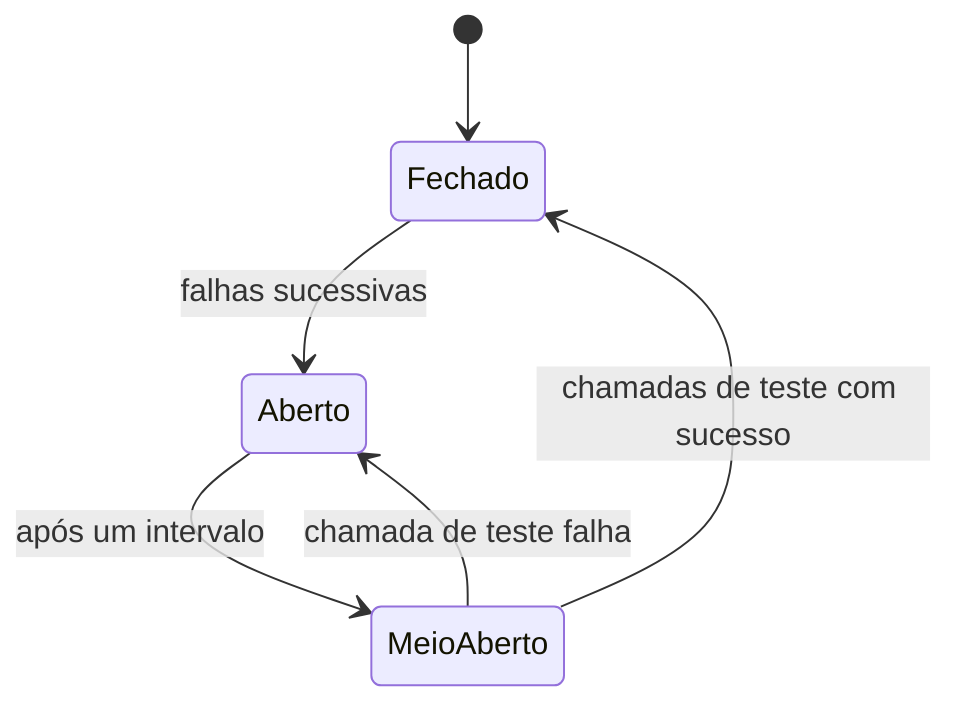

# Resiliência explicada

Guia didático de como o sistema se comporta sob carga alta e falhas parciais. A decisão formal está
no [ADR-0021](../adr/0021-resiliencia-sob-carga-e-falhas.md).

> **Situação:** hoje já existem quatro mecanismos. O lock da conta espera no máximo 2 s
> (`lock_timeout`). A leitura no MongoDB tem timeout de 300 ms, com fallback para o PostgreSQL. O
> relay do outbox repete um lote com falha depois de uma espera crescente. A Api e o Worker
> respondem à liveness em `/health/live`. O restante está previsto na funcionalidade **F7** do
> [roteiro](../roadmap.md): bulkhead, readiness e os demais timeouts. Rate limiting, load shedding,
> circuit breaker, pools separados e encerramento gracioso são complementos do F7, feitos se houver
> tempo. Cada seção abaixo diz o que já existe e o que é previsto.

## 1. Como sistemas colapsam

O sistema legado fica lento e instável no pico. Quase sempre o colapso segue o mesmo roteiro:

1. Chega mais tráfego do que o sistema consegue atender.
2. As requisições começam a esperar em fila.
3. Cada requisição esperando segura recursos: uma thread, uma conexão de banco, memória.
4. Os recursos acabam. Agora **até requisições simples** ficam esperando.
5. Os chamadores atingem seus próprios timeouts e **repetem a requisição**, o que aumenta ainda mais
   a carga.
6. O sistema passa a gastar todo o seu esforço em respostas que ninguém mais está esperando.

> **Analogia:** um restaurante lotado que continua aceitando todo mundo na porta. A cozinha não dá
> conta, a fila cresce, as pessoas desistem depois de pedir (comida feita para ninguém) e quem
> chega depois também não é atendido.

Cada mecanismo abaixo quebra um elo dessa corrente.

## 2. Proteção da entrada

Nenhum mecanismo desta seção existe ainda. O bulkhead está previsto no F7; rate limiting e load
shedding são complementos do F7.

### Rate limiting, limite de taxa (previsto, complemento do F7)

Cada sistema chamador (`client_id`) tem uma cota de requisições por segundo. Passou da cota,
recebe `429 Too Many Requests` com o cabeçalho `Retry-After` dizendo quando tentar de novo.

Usamos o algoritmo **token bucket** (balde de fichas): cada client tem um balde que é reabastecido
com fichas a uma taxa fixa. Cada requisição gasta uma ficha. Balde vazio, requisição recusada. O
balde permite pequenas rajadas (as fichas acumuladas) sem permitir abuso contínuo.

**Problema que resolve:** um sistema com defeito (por exemplo, em loop) não consome a capacidade
de todos os outros.

### Bulkhead, anteparas (previsto, F7)

> **Analogia:** navios são divididos em compartimentos estanques (anteparas). Se o casco fura em um
> compartimento, a água não inunda o navio inteiro.

Leituras e escritas têm **limites de concorrência separados**. Exemplo: no máximo 200 leituras e
100 escritas simultâneas. Se chegar um pico enorme de consultas de saldo, ele esgota apenas o
compartimento de leitura. **As movimentações financeiras continuam sendo registradas normalmente.**

Esse é o ponto mais diretamente ligado ao problema do legado: lá, provavelmente, um pico de
consultas derruba também o registro de movimentações.

### Load shedding, descarte de carga (previsto, complemento do F7)

Cada compartimento tem uma **fila curta**. Se a fila enche, a requisição recebe `503 Service
Unavailable` **imediatamente**, com `Retry-After`.

Parece contraintuitivo recusar trabalho, mas compare:

| Sem load shedding | Com load shedding |
|-------------------|-------------------|
| Todas as requisições esperam, todas ficam lentas, quase todas expiram | A maioria é atendida rapidamente; o excesso é recusado na hora |
| Falha lenta e total | Falha rápida e parcial |

Recusar rápido é um favor ao chamador: ele sabe na hora que precisa tentar de novo, em vez de
esperar 30 segundos por um timeout.

## 3. Timeouts: nada espera para sempre

Todo ponto em que o sistema espera algo deve ter um tempo máximo:

| Espera | Limite | O que acontece | Situação |
|--------|--------|----------------|----------|
| A requisição inteira | 5 s | Resposta `503` | Previsto (F7) |
| Lock da conta (outra transação usando a mesma conta) | 2 s | Resposta `409`; o chamador repete com segurança | Existe |
| Um comando SQL | 3 s | Transação desfeita | Previsto (F7) |
| MongoDB | 300 ms | Consulta respondida pelo PostgreSQL (fallback) | Existe; ajustável em `Positions:ReadTimeout` |
| OpenBao | 1 s | Operação com dados pessoais falha | Previsto (F5, junto com o OpenBao) |

O timeout não é o único motivo do fallback. A consulta também vai ao PostgreSQL quando o MongoDB
responde com erro ou quando está atrasado: a versão projetada da conta é diferente da versão no
PostgreSQL (ver o [guia do modelo de leitura](modelo-de-leitura-explicado.md)).

Sem timeout, uma dependência lenta prende recursos indefinidamente, e o problema de um componente
vira o problema de todos.

## 4. Lidando com dependências instáveis

### Circuit breaker, disjuntor (previsto, complemento do F7)

> **Analogia:** o disjuntor da sua casa. Se há um curto-circuito, ele desarma e corta a energia
> antes que o fio pegue fogo. Depois de um tempo, você religa para testar.

Se o MongoDB falhar várias vezes seguidas, o disjuntor vai **abrir**: por um período, o sistema nem
tentará chamar o MongoDB e irá direto ao fallback. Isso evita esperar 300 ms de timeout em cada
requisição para uma dependência que já sabemos estar fora. Hoje não há disjuntor: cada consulta
tenta o MongoDB e, se ele passar de 300 ms, responde pelo PostgreSQL.

Depois do período, o disjuntor fica **meio aberto**: deixa passar algumas chamadas de teste. Se
funcionarem, fecha (volta ao normal). Se falharem, abre de novo.

### Retry com backoff exponencial e jitter

Algumas falhas são passageiras (um pico de rede, por exemplo). Tentar de novo resolve. Mas tentar
de novo **imediatamente** e **todos ao mesmo tempo** piora as coisas.

- **Backoff exponencial:** espera cada vez maior entre tentativas (100 ms, 200 ms, 400 ms...).
- **Jitter:** um valor aleatório somado à espera, para que mil clientes não tentem de novo no mesmo
  milissegundo.

O retry com backoff e jitter do ADR-0021 ainda é previsto. Hoje há um único retry no sistema: o
relay do outbox, no Worker. Quando um lote falha, ele espera 1 s, 2 s, 4 s... até no máximo 30 s
antes de tentar de novo. É um backoff exponencial simples, sem jitter e sem biblioteca externa. A
espera volta a 1 s depois do primeiro lote com sucesso.

### Por que comandos não fazem retry interno

Retry interno parece ajudar, mas no momento de sobrecarga ele **multiplica** a carga: cada
requisição vira três. Esse fenômeno se chama *retry storm* (tempestade de retries).

Em vez disso, comandos falham de forma clara e quem decide repetir é o chamador, usando o **mesmo
`Idempotency-Key`**. Graças à idempotência (ADR-0037), repetir é sempre seguro: a operação acontece
no máximo uma vez.

O relay do outbox pode repetir porque a projeção é idempotente. As leituras não repetem: no
primeiro timeout ou erro do MongoDB, a consulta já responde pelo PostgreSQL.

## 5. Pools de conexão separados (previsto, complemento do F7)

O PostgreSQL aceita um número limitado de conexões. A aplicação mantém um **pool** (conjunto de
conexões reaproveitadas).

Se leituras e escritas compartilhassem o mesmo pool, um pico de leituras poderia ocupar todas as
conexões, e as escritas ficariam esperando. Por isso o desenho prevê **dois pools**: um para
escrita, outro para leitura. É o mesmo princípio do bulkhead, aplicado às conexões de banco. Os dois
pools ainda não existem.

## 6. Health checks: perguntar a coisa certa

Orquestradores (Kubernetes, por exemplo) perguntam periodicamente a cada réplica:

- **Liveness ("você está vivo?"):** se a resposta for não, o orquestrador **reinicia** a réplica.
- **Readiness ("você pode receber tráfego?"):** se a resposta for não, o balanceador **para de
  enviar requisições** para ela, sem reiniciar.

Hoje só a liveness existe: a Api e o Worker respondem em `/health/live`. A readiness está prevista
no F7.

Dois erros comuns, e como evitamos:

**Erro 1: liveness verificando o banco.** Se o PostgreSQL fica lento, todas as réplicas respondem
"não estou viva", e o orquestrador reinicia todas ao mesmo tempo. Reiniciar não conserta o banco, e
agora não há nenhuma réplica de pé. Por isso, a liveness verifica apenas se o processo responde:
ela não consulta nenhuma dependência.

**Erro 2: readiness da Api verificando o MongoDB.** Se o MongoDB cai, todas as réplicas dizem "não
posso receber tráfego", e a Api inteira some do balanceador. Mas a Api **consegue** atender sem o
MongoDB, usando o fallback para o PostgreSQL. Por isso, na readiness prevista, o MongoDB vai
aparecer apenas como **degradado**, sem tirar a Api do ar.

A tabela mostra a readiness prevista (F7):

| Componente fora | Api | Worker |
|-----------------|-----|--------|
| PostgreSQL | Não pronta (não registra nem consulta) | Não pronto |
| MongoDB | **Pronta**, degradada (consultas via fallback) | Não pronto (não consegue projetar) |
| OpenBao | Não pronta (operações de Customers falham) | Não afetado |
| Worker | Não afetada (outbox acumula, consultas via fallback) | — |

## 7. Encerramento gracioso (configuração própria prevista, complemento do F7)

Ao receber o sinal para desligar (por exemplo, numa nova implantação):

- **Api:** para de aceitar requisições novas e termina as que estão em andamento. Hoje isso é o
  comportamento padrão do ASP.NET Core, sem ajuste próprio; um encerramento configurado é
  complemento do F7.
- **Worker:** o sinal cancela o lote de eventos em andamento, se houver, e a transação do lote é
  desfeita. Os eventos daquele lote continuam pendentes no outbox e são processados pela próxima instância. Não
  há duplicidade porque a projeção só aplica a próxima versão de cada conta: um evento que já
  entrou é reconhecido e não entra de novo (ADR-0035).

## 8. Um pico de tráfego, do começo ao fim

O roteiro abaixo descreve o desenho completo. Os passos marcados como previstos ainda não
acontecem.

1. O tráfego de consultas triplica às 12h.
2. Clients acima da cota recebem `429` (rate limiting; previsto, complemento do F7).
3. O compartimento de leitura enche; o excesso recebe `503` imediato (load shedding; previsto,
   complemento do F7).
4. **O compartimento de escrita não é afetado:** débitos e créditos seguem normalmente (bulkhead;
   previsto, F7).
5. O MongoDB fica lento; leituras passam do limite de 300 ms e são respondidas pelo PostgreSQL.
   Isso já acontece hoje. O uso de um pool de leitura separado, sem tocar no pool de escrita, é
   previsto (complemento do F7).
6. O disjuntor do MongoDB abre; as consultas param de esperar o MongoDB (previsto, complemento do
   F7).
7. Os chamadores respeitam o `Retry-After` e repetem (previsto, junto com o rate limiting e o load
   shedding).
8. O pico passa, o disjuntor testa o MongoDB, fecha, e tudo volta ao normal sem intervenção manual
   (previsto, complemento do F7).

Em nenhum momento um débito foi duplicado, perdido ou aceito acima do limite.
