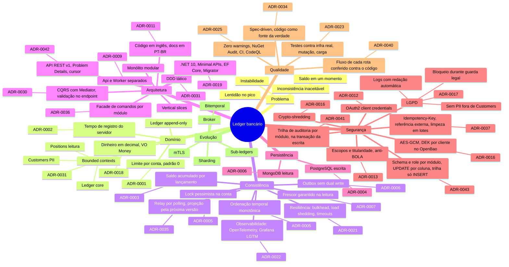
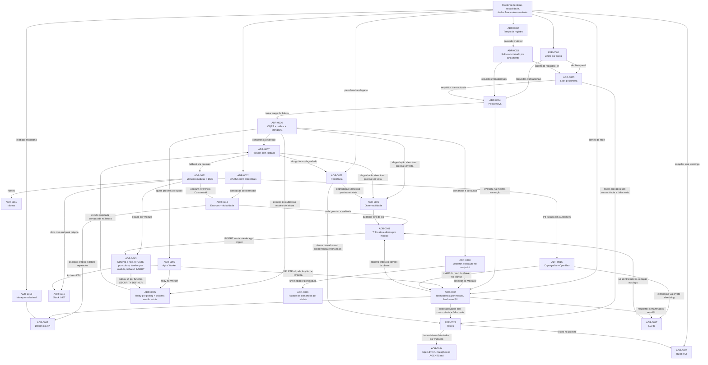

# Mapa de decisões

Visão geral de como o raciocínio foi organizado: do problema às decisões, e como cada decisão
abriu ou restringiu as seguintes. Os detalhes de cada ponto estão nos [ADRs](adr/README.md).

## Princípios que guiaram as escolhas

Em ordem de prioridade, quando entram em conflito:

1. **Correção antes de tudo.** Dinheiro não admite inconsistência: nenhum débito acima do limite,
   nenhum lançamento perdido ou duplicado, nenhuma consulta que omita uma operação confirmada.
2. **Segurança como requisito, não como camada.** Autenticação, autorização, idempotência,
   criptografia e LGPD entram no desenho desde o início.
3. **Uma única fonte da verdade.** O PostgreSQL do Ledger. Todo o resto é derivado e verificável.
4. **Falhas contidas.** Componente secundário (modelo de leitura, projetor) nunca derruba o
   principal (registro de movimentações).
5. **Desempenho por desenho, não por força bruta.** Consultas com custo independente do tamanho do
   histórico.
6. **Demonstrar o essencial, documentar a evolução.** O escopo implementado cobre os riscos
   centrais; o caminho para produção fica registrado em [melhorias futuras](melhorias-futuras.md).

## Mapa mental

## Encadeamento das decisões

Cada seta indica que a decisão de origem motivou ou restringiu a de destino.

## Perguntas que orientaram cada área

| Área | Pergunta | Resposta curta | ADR |
|------|----------|----------------|-----|
| Domínio | O que acontece quando um débito excede o saldo? | Rejeita além do limite da conta (padrão 0) | 0001 |
| Domínio | O que significa "saldo em um momento"? | Tempo de registro do servidor; sem retroativo | 0002 |
| Domínio | Como representar dinheiro sem erro de arredondamento? | `decimal` + `numeric(19,4)` no VO `Money`; JSON como string | 0018 |
| Desempenho | Como consultar saldo sem somar todo o histórico? | Saldo acumulado em cada lançamento | 0003 |
| Persistência | Onde guardar a fonte da verdade? | PostgreSQL | 0004 |
| Concorrência | Como impedir dois débitos simultâneos de estourar o limite? | Lock pessimista na conta, `CHECK` no banco | 0005 |
| Carga | Como impedir que picos de leitura degradem a escrita? | Modelo de leitura separado via outbox | 0006 |
| Consistência | Como o cliente nunca vê saldo sem uma operação confirmada? | Verificação de versão e fallback | 0007 |
| Consistência | Como o modelo de leitura recebe cada lançamento sem perder nenhum nem aplicar fora de ordem? | Relay do outbox por polling com `SKIP LOCKED` e cursor; projeção só da próxima versão da conta | 0035 |
| Código | Como despachar comandos sem risco de licença, e onde validar a entrada? | `Mediator` com geração de código; validação no endpoint (`LedgerInput`) | 0030 |
| Código | Como cada endpoint despacha para o mediador do próprio módulo? | Facade de comandos por módulo (`ICustomersCommands`, `ILedgerCommands`) sobre o `Mediator` gerado dele | 0036 |
| Resiliência | Falha no projetor pode derrubar a API? | Não: processos separados | 0009 |
| Resiliência | Como um pico de consultas não derruba o registro de movimentações? | Bulkhead leitura/escrita, load shedding, timeouts, pools separados | 0021 |
| Operação | Como enxergar degradação antes de virar incidente? | OpenTelemetry, métricas de negócio, trace atravessando o outbox, alertas como código | 0022 |
| Qualidade | Como provar que cada teste prova o cenário real? | Infra real, concorrência por barreira, mutação com Stryker, carga com k6 | 0023 |
| Processo | Como garantir que todo requisito vira teste e que "pronto" não é autoavaliação? | tlc-spec-lean com `mutations: N` no AGENTS.md, verificador independente, Stryker no CI; código como fonte da verdade | 0034 |
| Qualidade | Como garantir zero warnings e dependências sem vulnerabilidade? | `TreatWarningsAsErrors`, NuGet Audit, CI com CodeQL, actions por hash | 0025 |
| Documentação | O que documentar para outra pessoa entender e evoluir a solução? | ADRs, mapa, guias, modelo de falhas, modelo de ameaças, runbook, C4 | 0026 |
| Documentação | Como mostrar o caminho completo de cada rota sem o diagrama envelhecer? | Fluxo de cada rota e rotina em `docs/arquitetura/`, ligado a código e ADR, conferido contra `HEAD` no Verify | 0040 |
| Escopo | O que implementar no prazo e o que só documentar? | Núcleo completo (F0-F5, F10); operação reduzida (F6-F9) | 0027 |
| Processo | Onde ficam planos, checks e relatórios de verificação? | Em `.specs/`, local e não versionado; o que é permanente fica em `docs/`, e o comportamento vigente no código e nos testes | 0028 |
| Processo | Como tornar as specs e a verificação públicas sem versionar artefatos de trabalho? | PRD versionado; board com épicos (TDD) e user stories; relatório do verificador no épico | 0029 |
| Organização | Como expressar o domínio no código e manter fronteiras? | Monólito modular, vertical slices, DDD; `Money` e `Outcome` no domínio do módulo | 0031 |
| Clareza | Em que idioma escrever? | Código em inglês, documentação em PT-BR | 0011 |
| Tecnologia | Qual stack .NET e como aplicar migrações sem dar DDL à Api? | .NET 10, Minimal APIs, EF Core, `Migrator` dedicado | 0019 |
| Contrato | Como impedir que quem só credita consiga debitar? | Endpoints e escopos separados para crédito, débito e estorno; leitura mascarada e completa de cliente em rotas separadas, com o acesso completo na trilha de auditoria | 0042 |
| Segurança | Como identificar quem chama a API? | OAuth2 client credentials (Keycloak) | 0012 |
| Segurança | Como impedir que um canal acesse a conta de outro cliente? | Token exchange com `customer_id` e verificação de titularidade | 0013 |
| Segurança | Como um retry nunca duplica um lançamento? | `Idempotency-Key` na mesma transação + `UNIQUE` em `external_reference`; limpeza em lotes; hash por HMAC do cofre quando há dado pessoal | 0037 |
| Segurança | Como um módulo comprometido não alcança dados do outro? | Schema e role de banco por módulo; `UPDATE` por coluna; lançamentos sem `UPDATE`/`DELETE`; role de Worker por módulo; trilha de auditoria só com `INSERT` | 0043 |
| Segurança | Como provar quem movimentou uma conta ou acessou o CPF de um cliente? | Trilha de auditoria por módulo no banco, gravada na transação da escrita, só com identificadores e imutável; dado pessoal apagado dos logs pelo framework | 0041 |
| Segurança | Como proteger PII e ainda permitir eliminação, mesmo com backups? | AES-256-GCM com DEK por cliente no OpenBao; destruir a DEK elimina | 0016 |
| Privacidade | Como conciliar eliminação (LGPD) e dever de guarda (regulação financeira)? | Bloqueio imediato, eliminação automática ao fim da guarda | 0017 |
